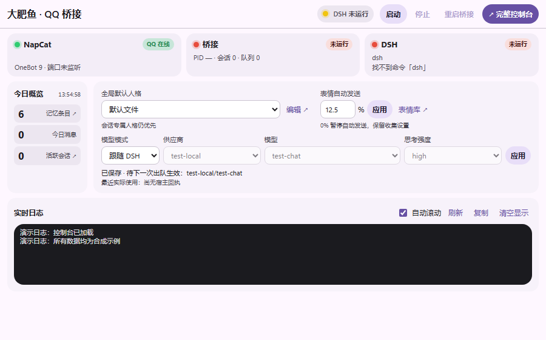
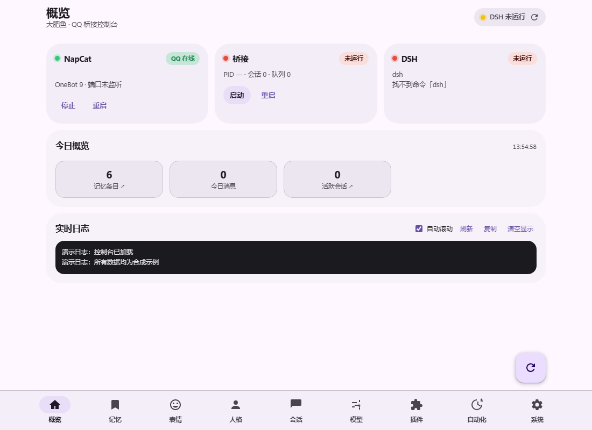
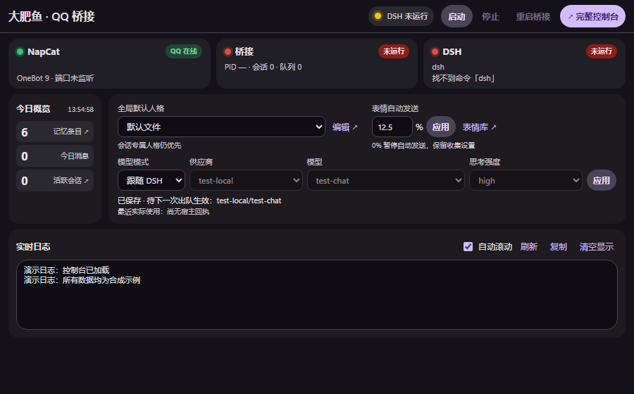

# QQ-DSH · 大肥鱼 QQ 桥接

运行在 DeepSeek Harness（DSH）中的 QQ 桥接插件：连接 NapCat，在 QQ 私聊或群聊中使用宿主 DSH，并从插件面板管理人格、模型、记忆、表情和日志。

**当前稳定版：v3.3.0，DSH bundle：qq-bridge-companion 0.3.0。** 从 [最新 Release](https://github.com/miku05231/DSH-Fatwhale-QQ/releases/latest) 下载完整项目，按下文安装 `src/companion`。改动见 [发行说明](docs/releases/v3.3.0.md)，验证范围见 [验证记录](docs/releases/v3.3.0-verification.md)。

> **插件安装入口是完整项目中的 `src/companion`。** Release 中的 exe 是旧独立启动器，插件用户无需下载或运行。安装、启停和打开控制台都从 DSH 插件页完成。

## 新版控制台

DSH 插件页展示紧凑面板；点击「打开完整控制台」，在系统默认浏览器中打开完整九页界面。图片均为隔离环境的**示例数据**。





<details>
<summary>深色面板</summary>



</details>

- **人格**：快捷切换全局默认人格，保留群／会话专属人格。
- **模型**：跟随或手动选择模型与推理强度，区分保存目标和最近实际使用；运行中的请求不变，后续出队请求读取新目标。
- **表情**：快捷区只修改发送概率，0 表示暂停自动发送，保留收集与表情库设置。
- **日志**：自动跟随、刷新、复制、清空当前显示；清空不删除磁盘日志。
- **本机联动**：一次性授权打开浏览器，无需复制 DSH 登录凭证；入口仅限本机。
- **安全启停**：内嵌页只控制当前桥接，NapCat 与 DSH 卡片只读。完整系统维护操作仍会影响相应进程。

完整界面保留概览、记忆、表情、人格、会话、模型、插件、自动化、系统九页。使用与安装细节见 [控制台使用](docs/console.md)。

## 功能

- 私聊、群聊、唤醒词、白名单与限流；可选 JEV／默认模型接话判定。
- Obsidian 格式记忆库、相关记忆召回、手动与定时反思。
- 全局与按会话人格、会话管理、模型跟随和手动选择。
- 表情收集与管理、可选生图和回复语音、B站自动化。
- JavaScript 插件；默认关闭的可选 AstrBot 运行时。
- DSH 插件页管理桥接，支持本机浏览器完整控制台；旧 Windows 托盘与独立入口仅用于兼容旧部署。

电脑工具仅对显式配置的管理员开放；普通成员使用受限聊天通道。DSH 0.2.2 的实现会加载执行器组件，通过权限限制和 guard 禁止普通成员使用工具，不能理解为完全没有加载执行器。相关边界由隔离测试验证。

## 环境与兼容性

| 环境 | 说明 |
| --- | --- |
| Windows 10/11 | 宿主 DSH、插件面板与本机完整控制台的主要使用环境 |
| Node.js | 桥接本体最低 22；DSH 0.2.2-rc.1 CLI 要求至少 24.9.0，使用该内核时须满足此要求 |
| DSH | 重点受控验证版本为 0.2.2-rc.1、0.2.1-rc.5；不是对未来版本的兼容承诺 |
| NapCat | OneBot 11 正向 WebSocket；可在 Docker 中运行，需自行准备并登录 QQ |
| 部署边界 | Docker 仅承载 NapCat；DSH 常驻宿主，由插件承载和管理桥接，见 [部署说明](docs/Docker部署.md) |

桥接本体无需安装 npm 依赖；先准备宿主 DSH 和 NapCat。本版完整 bundle 默认在 DSH 宿主进程内运行桥接核心，管理员请求直接使用该宿主。普通成员的隔离聊天仍需要可用、版本匹配的 DSH CLI，请配置好 `dsh.command`；安装了 Desktop 不代表系统已提供该命令。旧版本记录不作为本版全量验收。

## 安装与使用

### 1. 准备 DSH 和 NapCat

- 在宿主安装并配置 DSH，先确认其自身对话可用。
- 启动 NapCat，完成 QQ 登录，并启用 **OneBot 11 正向 WebSocket**。NapCat 可以单独运行在 Docker 中；DSH 和桥接插件运行在宿主。
- 确认宿主能访问 OneBot 地址，并准备其访问令牌（如已设置）。NapCat 管理页面地址与 OneBot 地址是两个入口。

### 2. 下载完整项目并准备配置

从 [最新 Release](https://github.com/miku05231/DSH-Fatwhale-QQ/releases/latest) 下载 `qq-bridge-3.3.0-source.zip`，解压到打算长期保留的目录。该目录应包含 `config.example.json`、`src/index.js` 和 `src/companion/package.json`。

在这个**完整项目根目录**打开终端，首次安装时创建配置：

```powershell
if (-not (Test-Path -LiteralPath config.json)) {
  Copy-Item -LiteralPath config.example.json -Destination config.json
}
# 编辑 config.json：OneBot 地址/令牌、聊天准入、管理员、DSH CLI 和工作目录
```

已有配置会保留。至少核对 `onebot.url`、`onebot.accessToken`（如需）、`security.allowFrom`、`security.adminUserIds` 和 `dsh.command`；需要群聊时再配置 `security.allowGroupIds`。将模板中的演示用户和群号替换为自己授权的账号。

私聊按 `allowFrom` 控制。模板同时开启 `allowGroups` 和 `allowGroupMembers`：允许接入的群内，其他成员也可能通过 @、唤醒词或接话判定触发聊天。若群聊也只允许白名单用户，将 `allowGroupMembers` 设为 `false`。管理员列表留空表示无人拥有电脑工具权限；群成员聊天资格不授予电脑工具权限。

`allowGroupIds` 非空时按名单限群；为空时回退到 `allowGroups`。模板的 `allowGroups: true` 意味着清空群名单会允许所有群（仍受拒绝名单约束）。保留明确的群 ID 名单；禁用群聊时清空群名单并设置 `allowGroups: false`。

`onebot.url` 使用**宿主可达**的正向 WebSocket 地址；Docker 内部服务名不能直接当作宿主地址。令牌须与 NapCat 对应端点一致。

### 3. 在 DSH 安装并启用插件

保留整个解压目录；`src/companion` 需要调用同一项目内的桥接和控制台文件。当前采用本地完整 bundle 安装。

**DSH Desktop 0.2.2：**

1. 打开 DSH 的插件管理页，添加本地目录。
2. 选择刚解压项目中的 `src/companion`，安装 `qq-bridge-companion`。
3. 启用插件，然后完全退出并重新打开 DSH。
4. 回到插件详情页，确认能看到「大肥鱼」控制面板。

Desktop profile 由桌面应用管理，使用上述原生安装入口。

**DSH Web 0.2.2：** 在项目根目录执行以下命令，然后重新启动使用该 profile 的 `dsh web`；在插件管理页确认插件已启用。

```powershell
$companionPath = (Resolve-Path src/companion).Path
dsh plugin --profile web add ("file:" + $companionPath.Replace('\', '/'))
```

### 4. 从插件面板使用

完整 bundle 默认 `runMode: embedded`，启用后自动启动桥接。保持 DSH 运行，在面板确认桥接和 NapCat 已连接，再从白名单 QQ 账号发消息。

- **启动／停止／重启桥接**：只操作当前插件的桥接，停止桥接后 DSH 继续运行。
- **打开完整控制台**：点击面板按钮，由系统浏览器打开；地址和一次性授权自动生成，无需手填固定端口。
- **修改人格、模型、表情及其他设置**：使用快捷区或完整控制台。模型新目标在后续请求应用。

插件运行期间，使用 DSH 插件页作为唯一桥接启动入口，避免旧托盘或命令行重复连接同一 NapCat。更新项目文件后重新启动 DSH，使进程内模块加载新版本。

源码与配置分开放置，或从旧 server-only 版本迁移时，按 [控制台安装与迁移](docs/console.md) 设置 `projectRoot`、`configFile`、`workspacePath`、`sessionMapPath` 及 `runMode: embedded`。旧 `tools/install-companion.mjs` 仅注册服务端连伴，完整面板使用上述 bundle 安装流程。

## Release 文件怎么选

| 文件 | 用途 |
| --- | --- |
| `qq-bridge-3.3.0-source.zip` | **插件用户推荐**：完整项目文件，解压后在 DSH 安装其中的 `src/companion` |
| `qq-bridge-3.3.0-portable-win64.zip` | 完整 Windows 便携目录，额外带旧启动器；也可从其中安装 bundle |
| `qq-bridge-launcher-3.3.0.exe` | **旧部署兼容启动器**：管理托盘和独立服务；依赖完整目录与外部运行环境，插件模式不使用 |
| `SHA256SUMS.txt` | 核对上述三个文件的 SHA256 |

独立 exe 不是 DSH 插件安装包，也不能单独更新插件。保留旧部署的用户可参考 [历史更新说明](docs/更新发布.md)；新安装使用上面的插件流程。

## 配置与权限

模板见 [config.example.json](config.example.json)。关键字段：

| 字段 | 用途 |
| --- | --- |
| `onebot.url` | NapCat 正向 WebSocket 地址 |
| 插件 `runMode` | 完整 bundle 默认 `embedded`；旧 server-only 迁移需明确设为 `embedded`，见控制台说明 |
| `security.allowFrom` | 私聊用户白名单；关闭群成员模式时也约束群聊发言者，**不授予电脑工具权限** |
| `security.adminUserIds` | 显式授权的电脑工具管理员；管理员也需满足聊天准入规则 |
| `security.allowGroups` | 群 ID 名单为空时的群聊开关；模板为 `true` |
| `security.allowGroupIds` | 非空时仅接入名单群；为空时按 `allowGroups` 决定 |
| `security.allowGroupMembers` | 允许接入群内的其他成员参与聊天；模板为 `true`，只限白名单用户时改为 `false` |
| `dsh.command` | DSH 命令或单个 CLI 文件路径，不拼接参数 |
| `dsh.cwd` | QQ 对话工作目录 |
| `memory.root` | 记忆库目录 |

控制台可修改的字段、鉴权及入口见 [架构说明](docs/控制台架构.md)。不要提交真实配置、QQ 标识、密钥、DSH profile、日志、记忆或工作区内容。

## 扩展与部署

- [JavaScript 插件与控制台架构](docs/控制台架构.md)
- [AstrBot 可选运行时](docs/astrbot.md)
- [生图](docs/image-generation.md) · [多平台媒体](docs/media-providers.md)
- [自动化与语音](docs/automation-and-voice.md)
- [NapCat Docker 与宿主插件的部署边界](docs/Docker部署.md)
- [测试清单](docs/测试清单.md) · [更新与发布](docs/更新发布.md)

## 测试

在干净源码副本中使用临时配置、本机假模型和假 NapCat。浏览器检查使用新的 Edge 资料目录：

```powershell
# 指向已安装且版本匹配的真实 DSH CLI，不使用可能回退旧版本的 shim
$env:QQ_TEST_DSH_COMMAND = '<DSH包目录>/lib/bin.js'
$env:QQ_TEST_DSH_VERSION = '0.2.2-rc.1'
node tests/run-all.mjs
```

依赖、专项命令、候选结果和未验证项见 [测试清单](docs/测试清单.md) 与 [本版验证记录](docs/releases/v3.3.0-verification.md)。隔离测试不需要真实 QQ 或在线模型密钥；真实环境测试单独说明。

## 许可与第三方协议

本项目采用 MIT，见 [LICENSE](LICENSE)。DSH、NapCat、AstrBot 和内置第三方代码遵循各自许可证。

本项目非腾讯官方产品，QQ 连接依赖第三方协议端 [NapCat](https://github.com/NapNeko/NapCatQQ)。使用前自行了解平台规则并评估账号风险。
