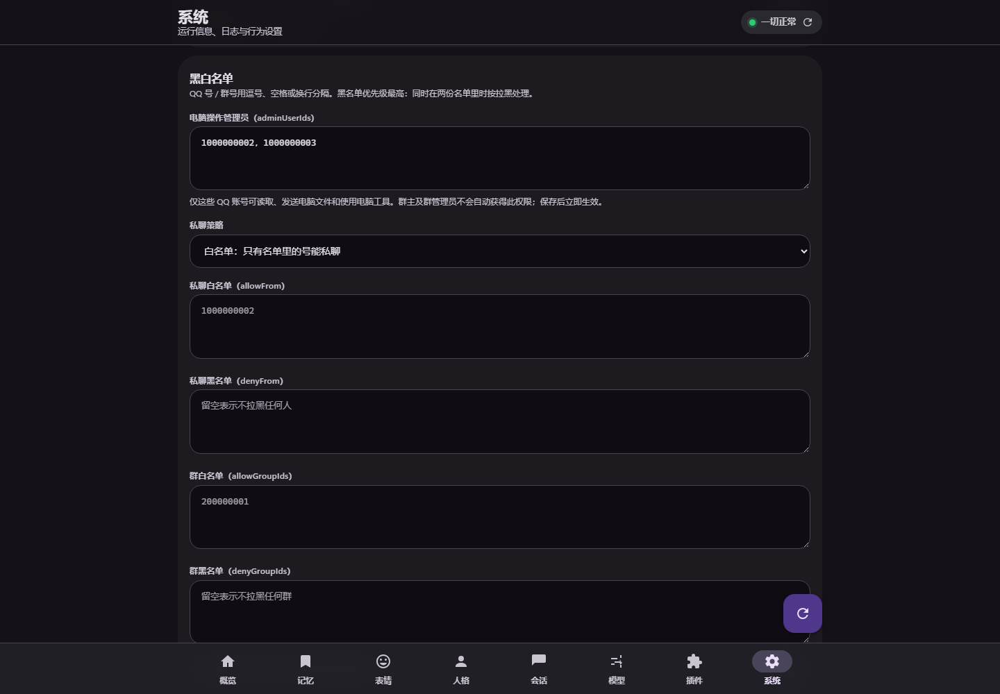
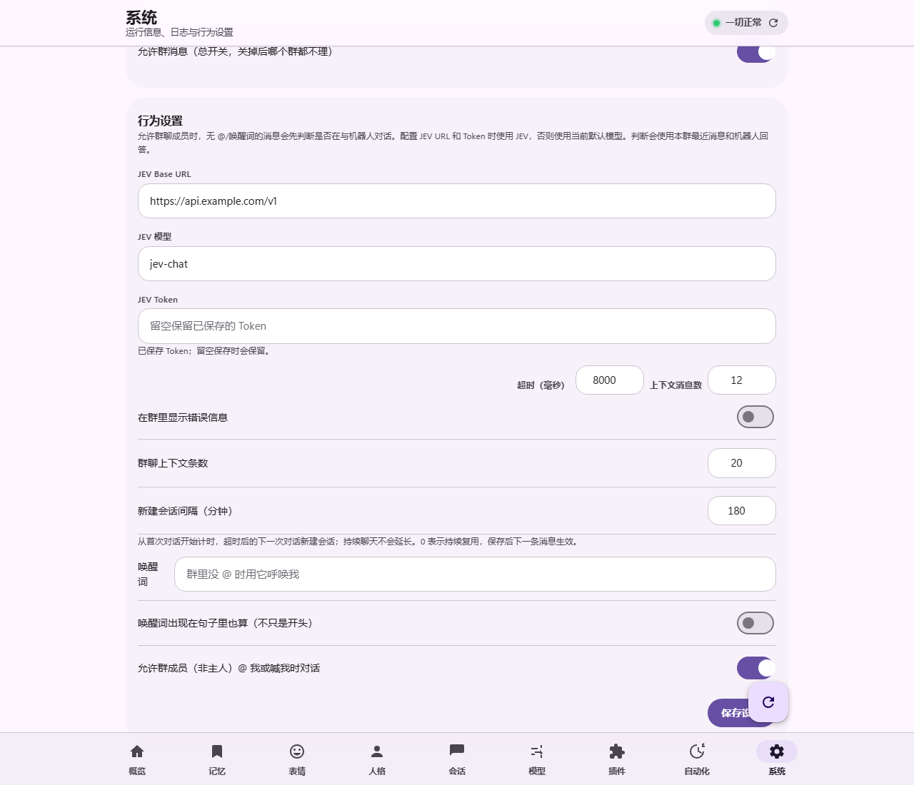
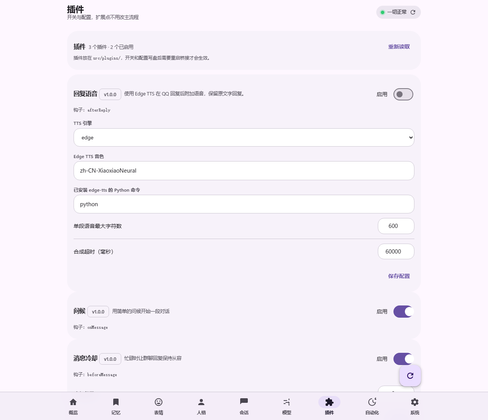
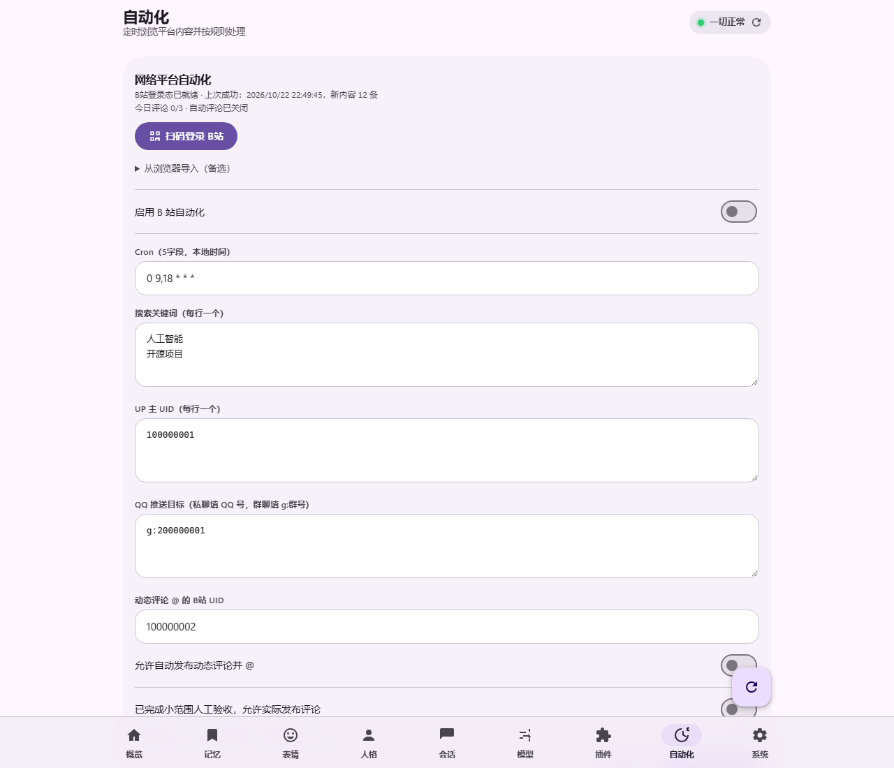
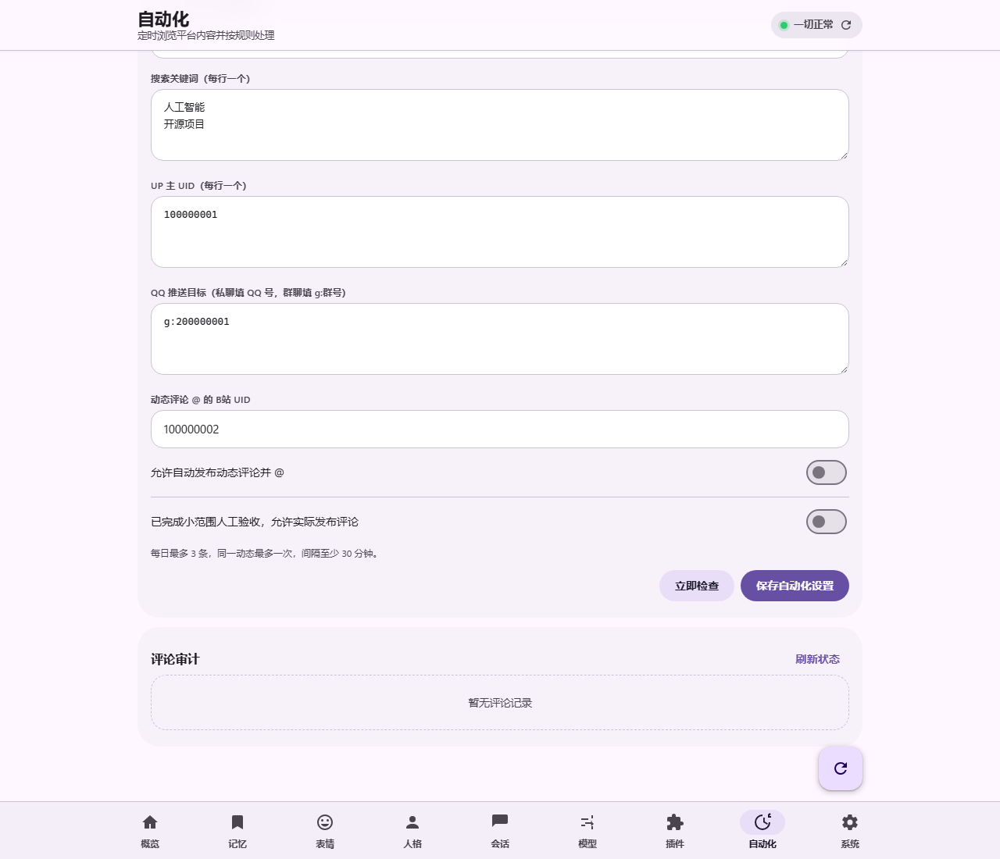

<!-- showcase:start -->
<p align="center">
  <a href="deepseek-waitou.png"></a>
</p>

# QQ-DSH · 在 QQ 里和 DeepSeek Harness 聊天

你在手机或电脑 QQ 里发消息，本机 DSH 执行并回复。

当前版本：**v3.1.5**。新增 NAS Docker 与局域网媒体支持，修复文件交付、DSH 状态显示和更新器残留锁，详见 [发行说明](docs/releases/v3.1.5.md)。

应用图标源文件：[deepseek-waitou.png](deepseek-waitou.png)（保留原始 PNG）。

多平台生图与语音：支持 ComfyUI 异步生图、OpenAI、硅基流动和自定义兼容接口；TTS 继续支持 Edge。密钥可选，配置入口与格式见 [多平台接入](docs/media-providers.md)，生图任务恢复见 [生图文档](docs/image-generation.md)。

DSH 兼容性：已分别使用 `0.2.0-rc.2` 和 `0.2.1-rc.3` 验证真实 Web、companion 与 headless 链路；详见各版本验证说明。

## 项目展示

控制台截图来自实际页面，状态、消息数、人格与记忆内容均为隔离的演示数据。托盘菜单和退出确认框使用 Windows 原生控件实际渲染，以下展示 150% 缩放效果。

**控制台 · 概览**


**托盘 · 右键退出**

| 浅色 | 深色 |
| :---: | :---: |
|  |  |
|  |  |

菜单和确认框跟随 Windows 应用主题；退出时停止桥接与 NapCat，DSH 继续运行。

**应用更新 · 确认后安装**


更新截图中的 `0.2.0 → 0.3.0` 为演示数据。客户端检查正式 Release，确认安装后保留本机配置、人格与记忆。

**电脑操作 · 仅管理员授权**



只有明确配置的管理员 QQ 账号可读取、发送本机文件和调用电脑工具；普通成员使用独立的无工具聊天通道。

**v3.0.0 · JEV / 默认模型接话判定**



JEV URL 和 Token 均已填写时使用 JEV，缺任一项时使用当前 DSH 默认模型。按群读取有限上下文与机器人回答，判定失败或超时保持静默；白名单、黑名单和限流先执行。

**v3.0.0 · 回复语音插件**



文字发送成功后可追加 QQ 语音。语音默认关闭，合成或发送失败保留文字；此版本不包含语音识别和翻译。

**v3.0.0 · B站自动化**



支持扫码登录、关键词搜索、UP 动态订阅、本地时间 Cron、去重和 QQ 摘要推送。自动化默认关闭，需自行配置来源与目标。

<details>
<summary>自动评论、指定 UID @ 与审计</summary>



自动评论默认关闭，还需显式确认已完成人工验收；同一动态最多尝试一次，每日最多 3 次、间隔至少 30 分钟，失败或结果不确定时停止发布，不自动重试。

</details>

以上新功能截图由实际前端在隔离演示服务中渲染；地址、账号、登录状态与运行结果均为演示数据，不代表真实发布记录。重现方式：`node scripts/capture-showcase.mjs --features-only`。

<details>
<summary>更多控制台页面：深色概览、记忆、人格、模型与移动端更新提醒</summary>

**深色概览**


**记忆 · 检索与定时反思**


**人格 · 多套人格管理**


**模型 · 跟随桌面端或手动指定**


**移动端**


**新版提醒**


</details>
<!-- showcase:end -->

> 非官方项目。QQ 侧通过第三方协议端 [NapCat](https://github.com/NapNeko/NapCatQQ)（OneBot 11）连接，**不符合腾讯服务条款，有封号风险**。请使用小号，并自行评估。

## 它能做什么

- **私聊 / 群聊**：私聊免唤醒；白名单群可由 JEV 或当前默认模型判断是否接话，明确 @ 或唤醒词沿用原规则
- **JEV 判定**：URL 和 Token 均非空时使用 JEV，否则使用当前 DSH 默认模型；按群使用有限上下文，失败或超时不回复
- **回复语音**：可选 Edge TTS 插件，文字成功发送后追加 OneBot 语音；失败保留文字，默认关闭
- **B站自动化**：扫码登录、关键词搜索、UP 动态订阅、本地时间 Cron、QQ 摘要推送和评论审计；可选低频评论与指定 UID @，默认关闭
- **长期记忆**：对话自动落盘到 Obsidian 笔记库（日志 / 人物页 / 群页 / 反思），回复前按相关度召回
- **记忆反思**：控制台记忆页「立即反思」手动跑一次；也能每天定时（默认 04:00，关机错过会补跑），重写前自动备份成 `.bak-时间戳`
- **模型跟随**：读 DSH 桌面端的当前模型，QQ 侧下一条消息立刻跟着换，无需重启
- **人格**：用一份 `AGENTS.md` 定义它是谁、怎么说话
- **Native 能力**：DSH 的 MCP 工具与 skills 原样可用（drawio、duckduckgo、windows…）
- **控制台**：`127.0.0.1:5830`，九个页签（概览 / 记忆 / 表情 / 人格 / 会话 / 模型 / 插件 / 自动化 / 系统），可启停服务、改设置、看日志
- **表情包库**：自动收集聊天里的表情并打标签（来源 / 群 / 谁发的 / 关键词 / 动图静态 / 尺寸），可筛选、改标签、换存放目录、重建索引
- **插件**：往 `src/plugins/` 扔一个 .js 就能加功能，控制台自动生成开关与配置表单
- **托盘 / 自启**：一键启动全部、左键直达控制台、开机自启；托盘与窗口图标用 `assets/app-icon.png`
- **应用更新**：系统页检查 GitHub 稳定版 Release；Windows 便携版确认后校验、备份并升级，独立 Git 源码目录可安装对应发布标签（要求无未提交修改且可快进），保留本机数据。Docker 按部署方式更新，发布步骤见 `docs/更新发布.md`。

## 环境要求

- Windows 10/11（托盘用 WinForms，测试与 CDP 用 Edge）
- Node.js ≥ 22（无需 npm install；内置第三方代码保留许可证）
- DSH（DeepSeek Harness）已安装并可用 `dsh` 命令
- NapCat（同一个发布包里的无头版本即可，无需另装 QQ 客户端）

Docker 部署见 [部署说明](docs/Docker部署.md)；[历史容器验证](docs/Docker验证报告.md) 不代表 v3.1.3 已完成真实容器测试。

## 快速开始

```powershell
# 1) 复制配置模板并改成你自己的
Copy-Item config.example.json config.json

# 2) 启动 NapCat（首次要扫码登录）
cd napcat; .\node.exe index.js -q <你的机器人QQ号>

# 3) 启动桥接
node src\index.js

# 4) 打开控制台
node src\webui\server.mjs   # 然后访问 http://127.0.0.1:5830
```

也可以双击 `launcher\一键启动.cmd`（托盘版，会依次拉起 NapCat → 桥接 → 控制台 → DSH）。

## 配置

见 `config.example.json`，每个字段都有注释式说明写在 `docs/控制台架构.md` 与 `README.md`（本文件由导出脚本生成，更完整的说明在导出的 `README.md` 之外的 `docs/`）。

关键字段：`onebot.url`、`security.allowFrom`（主人 QQ）、`security.allowGroupIds`、`behavior.wakeWord`、`dsh.command` = `dsh`、`memory.root`（Obsidian 库路径）。

## 测试

在未创建 `config.json` 的干净源码目录运行。真实内核默认 DSH `0.2.0-rc.2`，可显式选择新版，浏览器检查使用 Edge。

```powershell
$env:QQ_TEST_DSH_COMMAND = 'dsh' # 已安装 0.2.0-rc.2 的命令，也可填写 lib\bin.js 的绝对路径
$env:QQ_TEST_DSH_VERSION = '0.2.0-rc.2' # 必须与上述入口匹配；新版已验证 0.2.1-rc.3
$env:QQ_TEST_BROWSER_EXE = 'C:\Program Files (x86)\Microsoft\Edge\Application\msedge.exe'
node tests\run-all.mjs
node tests\plugins-test.mjs # 单跑插件宿主
```

全量套件使用临时配置与 DSH_HOME、假 NapCat 和本机模型端点，不需要真实 QQ 账号或在线模型密钥。真实 NapCat、Docker 和 Electron 桌面验证按各测试的要求单独执行。

## v3.1.3 安全与运行修复

命令行启停核对本安装的入口脚本；修复自定义配置文件名、命令行与环境变量优先级，以及相对环境路径。私聊黑名单模式不再绕过群成员白名单；过期限流记录定期清理，活跃额度保留。NapCat 健康工作线程不继承测试入口参数。

本版修复使用模拟 NapCat、隔离配置与测试进程验证。详见 [v3.1.3 验证说明](docs/verification-v3.1.3.md) 和 [发行说明](docs/releases/v3.1.3.md)。真实 QQ 投递、长期登录、真实平台发布、Docker 与 macOS 未新增验收。

## v3.1.2 修复与验证范围

本版修复原会话的模型与思考档位切换，控制台区分目标、实际、待应用与失败；保存合法目标后下一条 QQ 消息应用并同步已打开页面，选择失败不继续使用旧模型。改进 NapCat 实际登录检测、安装归属、端口冲突恢复与脱敏健康日志。

真实隔离 Electron 24/24、DSH Web + Edge 19/19、companion 55/55、独立宿主 13/13 通过；其他专项结果见验证说明，不把旧版全量结果计为本版全量验证。真实只读检查覆盖 QQ 在线和一次 NapCat 快速登录恢复，不发送真实 QQ 验收消息。

**未完成**：真实 QQ 文字/语音投递、QQ 定时推送、B站实际评论与 @、长期真实群聊判定，以及完整工作日登录稳定性、网络切换、休眠及 Windows 用户注销恢复，本版 Docker 和其他系统。语音与平台功能沿用旧版的未实测边界；不能承诺永久免重新授权，也不自动启用自启。

详见 [功能配置](docs/automation-and-voice.md)、[测试与未测试说明](docs/verification-v3.1.2.md) 和 [v3.1.2 发行说明](docs/releases/v3.1.2.md)。历史说明保留于 [v3.1.0](docs/releases/v3.1.0.md) 和 [v3.1.1](docs/releases/v3.1.1.md)；这两个标签未创建正式 Release。

## 插件

```js
export const meta = {
  name: 'ping',
  displayName: 'Ping',
  version: '1.0.0',
  description: '收到 /ping 时回一句',
  configSchema: [{ key: 'reply', type: 'string', label: '回复', default: 'pong' }],
};
export async function onMessage(ctx) {
  if (!ctx.text.startsWith('/ping')) return;
  await ctx.reply(ctx.config.reply);
  return { handled: true };
}
```

三个钩子：`onMessage` / `beforeReply` / `afterReply`；插件按文件名排序，异常只记日志。详见 `docs/控制台架构.md`。

## 目录

```
src/         桥接主体（index / onebot / dsh / security / memory / groupmem / plugins / model-follow）
src/webui/   控制台（零依赖 HTTP + Material 3 前端）
src/plugins/ 插件
launcher/    Windows 托盘（PowerShell 5.1 + WinForms）
tools/       命令行工具（qq / memory / model / reflect / export-public）
tests/       自测（假 NapCat、假 dsh、CDP 真渲染）
docs/        架构与测试清单
```

## 许可

MIT，见 `LICENSE`。QQ 协议端是第三方项目，按其自身许可使用。
