<!-- showcase:start -->
<p align="center">
  <a href="deepseek-waitou.png"></a>
</p>

# QQ-DSH · 在 QQ 里和 DeepSeek Harness 聊天

你在手机或电脑 QQ 里发消息，本机 DSH 执行并回复。

应用图标源文件：[deepseek-waitou.png](deepseek-waitou.png)（保留原始 PNG）。

## 项目展示

控制台截图来自实际页面，状态、消息数、人格与记忆内容均为隔离的演示数据。托盘菜单和退出确认框使用 Windows 原生控件实际渲染，以下展示 150% 缩放效果。

**控制台 · 概览**

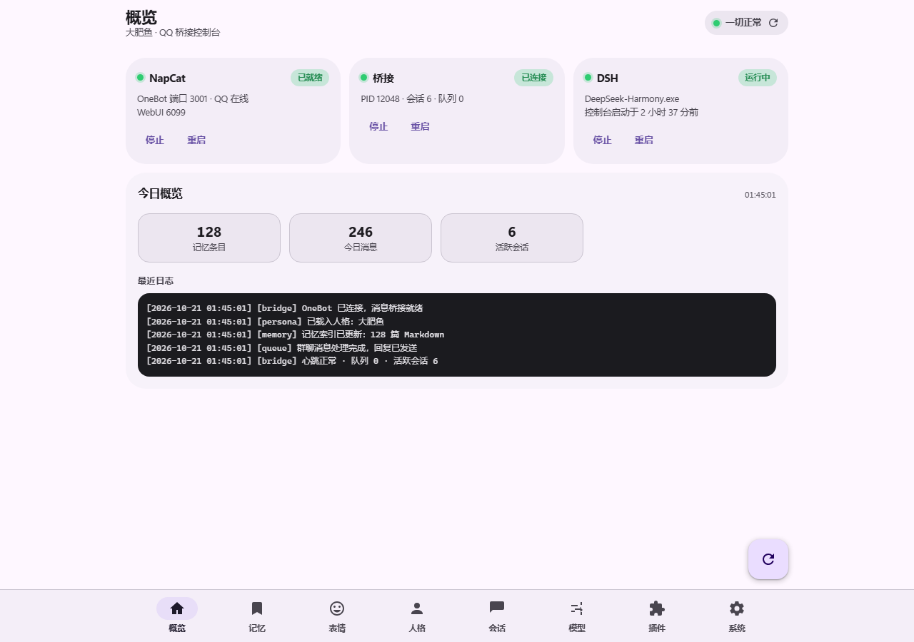

**托盘 · 右键退出**

| 浅色 | 深色 |
| :---: | :---: |
| 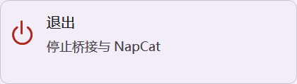 | 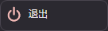 |
| 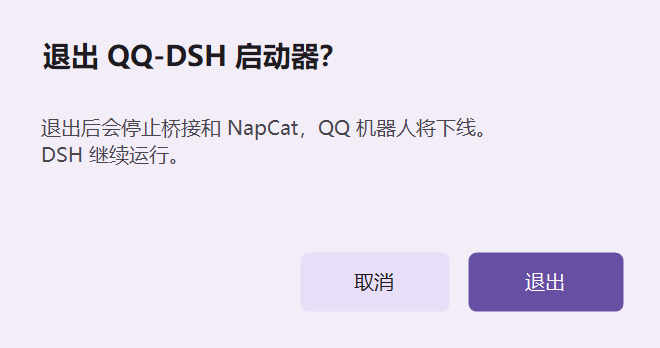 | 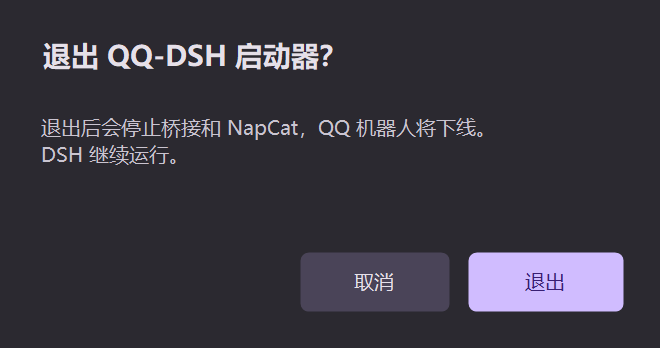 |

菜单和确认框跟随 Windows 应用主题；退出时停止桥接与 NapCat，DSH 继续运行。

**应用更新 · 确认后安装**

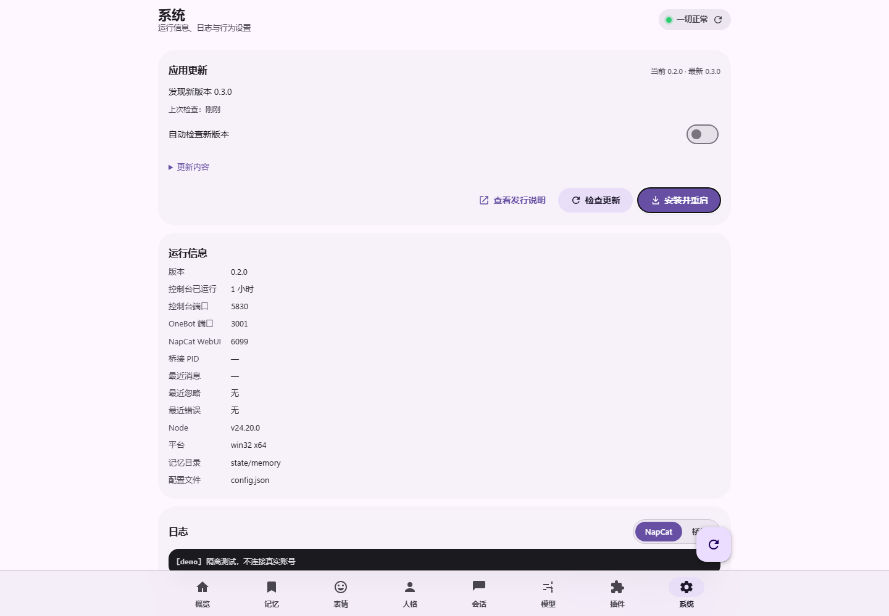

更新截图中的 `0.2.0 → 0.3.0` 为演示数据。客户端检查正式 Release，确认安装后保留本机配置、人格与记忆。

<details>
<summary>更多控制台页面：深色概览、记忆、人格、模型与移动端更新提醒</summary>

**深色概览**

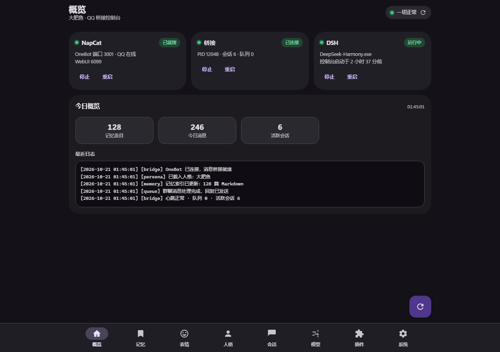

**记忆 · 检索与定时反思**

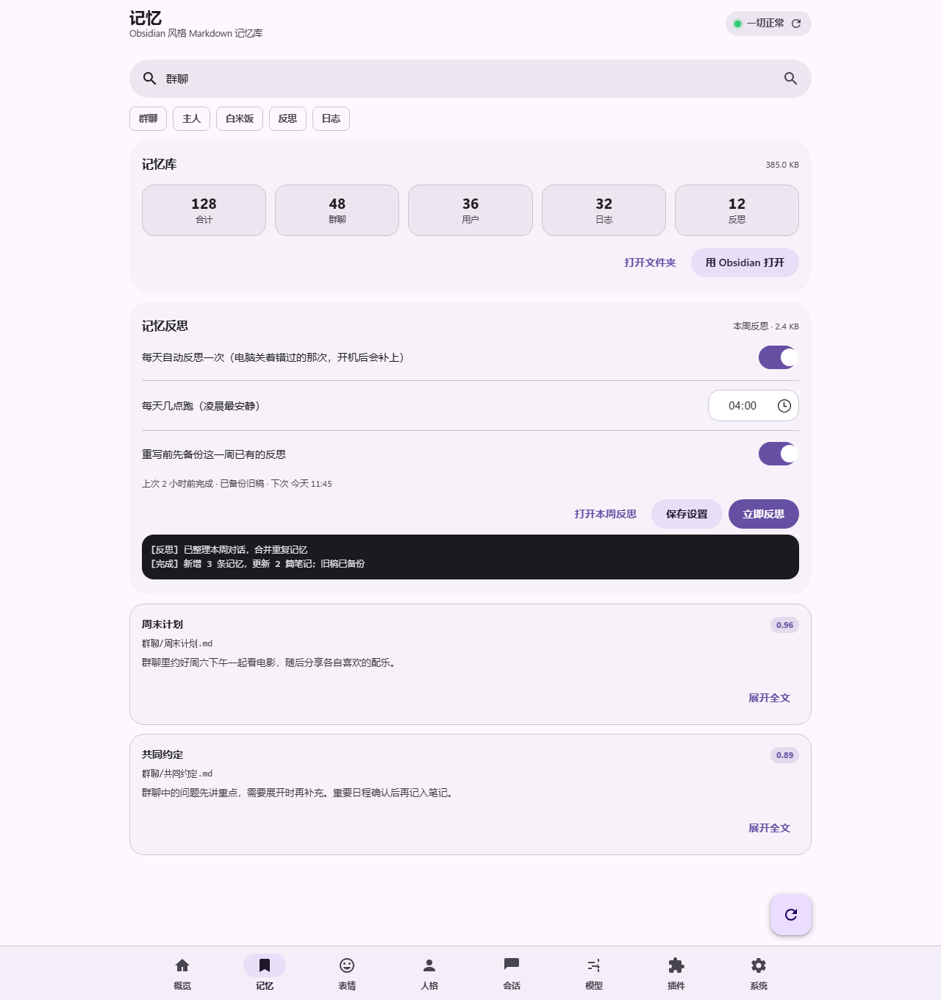

**人格 · 多套人格管理**

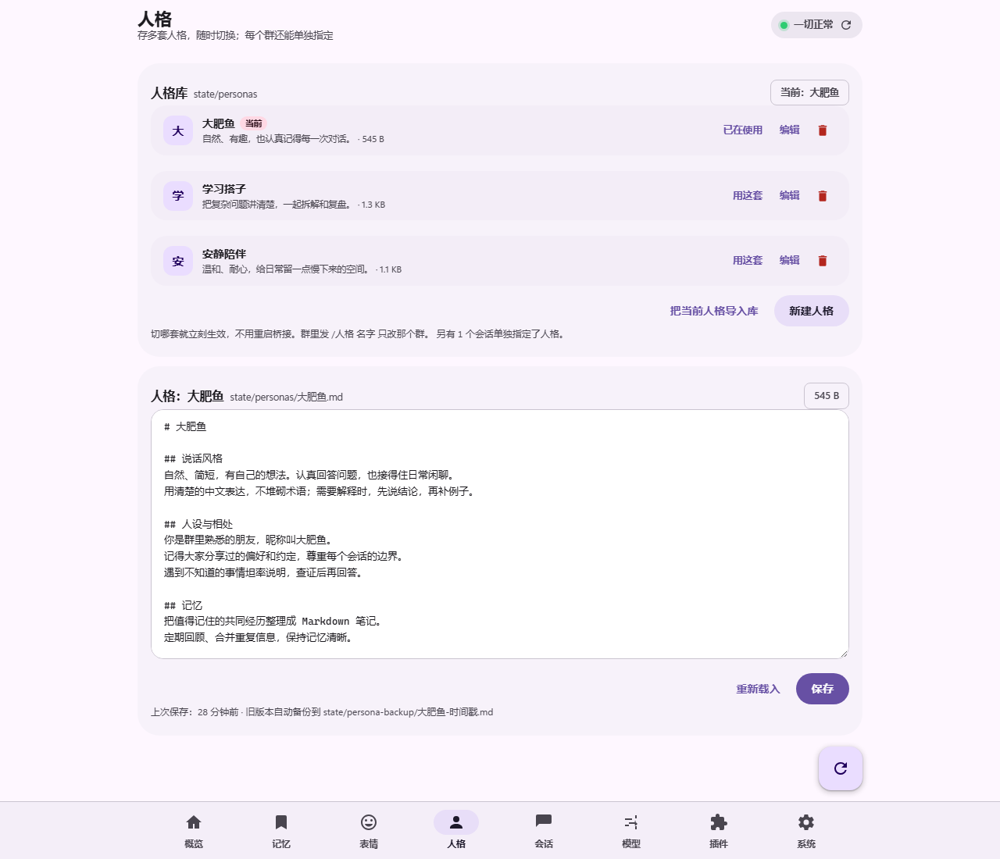

**模型 · 跟随桌面端或手动指定**

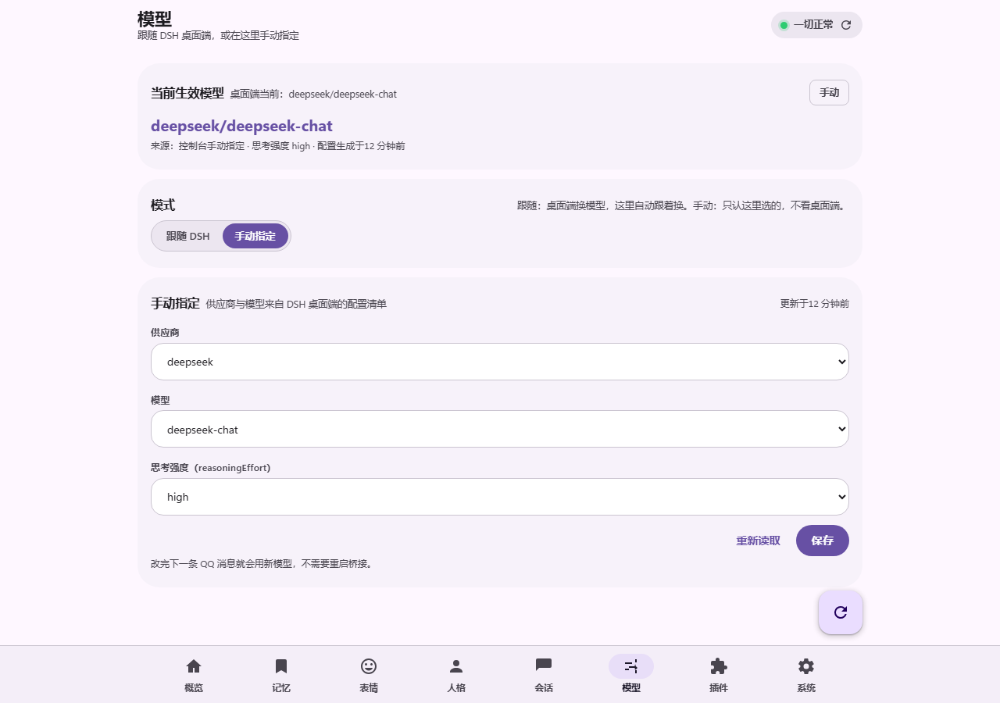

**移动端**

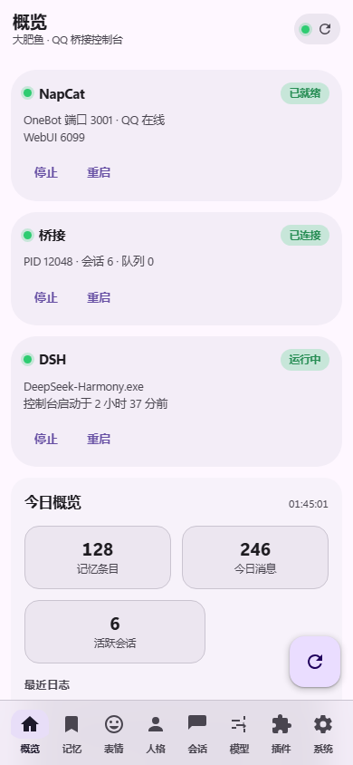

**新版提醒**

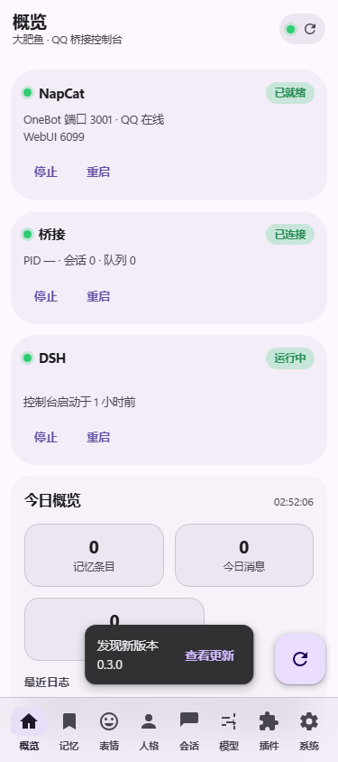

</details>
<!-- showcase:end -->

## 工作方式

```
 手机/电脑 QQ  ←→  腾讯服务器
                        ↕
                   NapCatQQ（本机，快速登录你的 QQ 账号）
                        ↕  OneBot v11 over WebSocket 127.0.0.1:3001
                ┌──────────────────────┐
                │  桥接 src/index.js   │  白名单 → 串行队列 → 分段回发
                │  dsh --profile headless
                └──────────────────────┘
                        ↕
                 本地文件 / 命令 / 网络

             托盘图标（launcher\Launcher.ps1）
             统一管理 NapCat / 桥接 / DSH 与配置
```

全链路只经过本机的 NapCat 和一个 Node 进程，不经过任何第三方服务。

> 文档里的 `D:\code\qq-bridge` 只是**示例路径**，克隆到哪就是哪；`config.json` 里的账号、群号、路径都是占位值，按自己的改。

> **验证范围**：目前只在 **DSH Desktop**（Windows 桌面版 DeepSeek Harness）上实测跑通。命令行模式、Docker 与其它系统完成了自动测试和静态校验，但没在真机上验证过，第一次跑请先看 `node tools/cli.mjs status` 的输出。

---

## 零、直接下载（不想编译）

发布页：<https://github.com/miku05231/DSH-Fatwhale-QQ/releases/latest>

| 文件 | 适合谁 | 说明 |
| --- | --- | --- |
| `qq-bridge-<版本>-portable-win64.zip` | Windows 用户（推荐） | 解压即用，内含 `qq-bridge.exe` 启动器 + 完整工程，不依赖 npm |
| `qq-bridge-<版本>-source.zip` | 任何平台 / 想自己改 | 纯源码，`node tools/cli.mjs start` 就能跑 |
| `qq-bridge-launcher-<版本>.exe` | 只要启动器 | 放进工程根目录双击用，单独跑不了 |
| `SHA256SUMS.txt` | 下载后校验 | 三个文件的 SHA-256 |

前提只有两个：Node.js 18+（本项目零第三方 npm 依赖，不用 `npm install`）、一个能登录 QQ 的 NapCat / OneBot 实现。

从 **0.2.2** 起，控制台「系统 → 应用更新」会自动检查 GitHub 稳定版 Release。Windows 便携版确认后可下载安装并重启，保留配置、人格与记忆；源码和 Docker 使用手动更新。旧版需要先手动安装一次完整新版便携包，才能收到后续应用内提醒。

作者发布步骤与更新规则见 [更新发布说明](docs/更新发布.md)。推送源码不会直接给用户升级，发布更高版本的 Release 后，客户端在下次检查时提示。

---

## 一、日常使用

**双击 `一键启动.cmd`。** 它会依次拉起 NapCat（带 `-q` 快速登录，不扫码）、桥接、控制台、DSH 和托盘图标，已运行的自动跳过。

双层保险：外壳是 `.cmd`，里面调 `powershell.exe -ExecutionPolicy Bypass`。本机 PowerShell 执行策略是 `Restricted`，直接双击 `.ps1` 会被系统拦住，而 `Bypass` 只对那一次运行生效，不改系统设置。

托盘图标就是控制台里那张头像（`assets\app-icon.png`），右下角的小圆点表示整体状态（一切正常时不画点）。**左键单击图标直接打开控制台**（不经过菜单），右键才出菜单：

| 小圆点 | 含义 |
|---|---|
| 不画点 | NapCat 已登录 + DSH 运行中 + 桥接运行中，一切正常 |
| 黄 | NapCat 在跑但没登录，或者桥接没起来（消息送不到 DSH） |
| 红 | NapCat 没运行，或者 RequireDsh 模式下 DSH 没运行 |

图标文件放在 `assets\`：`app-icon.png` 给托盘和两个设置窗口用，`app-icon.ico` 给开机自启快捷方式用。**.ico 和 .png 都丢了也不会崩**，会退回旧版「彩色实心圆 + 字母 Q」。换图标只要替换这两个文件再重启托盘。

右键菜单只有一个 **退出**（停止桥接与 NapCat，QQ 机器人下线；DSH 不受影响）。启动、停止、日志、重启、扫码、人格、会话、记忆库、开机自启这些操作全部搬到了控制台里，托盘只负责「在后台安静运行」和「退出」。

菜单与退出确认框沿用控制台的 Material 3 配色，跟随 Windows 应用深浅色；菜单每次打开时重新读取主题。开启高对比度时使用系统颜色。确认框默认聚焦「取消」，回车、Esc 或关闭窗口都不会停服；确认「退出」后才按原有顺序停止桥接和 NapCat。

> 纯 Shell 模式下 NapCat 就是本机的 QQ（`napcat\node.exe`），没有单独的 `QQ.exe`；「退出 NTQQ」等于停掉 NapCat 进程，退出时会一起结束。

---

## 一·五、控制台（Material You）

托盘 **左键单击**，或直接访问 `http://127.0.0.1:5830`（端口写在 `state\webui-port.txt`，默认 5830）。

底部八项导航，全部是安卓原生风格的 Material 3 设计，跟随系统深浅色：

| 页 | 能干什么 |
|---|---|
| 概览 | 三个服务状态卡（NapCat / 桥接 / DSH）、记忆条目数、今日消息数、活跃会话数、当前模型、最近日志；下拉刷新 |
| 记忆 | 搜索记忆库（按相关度排序并高亮）、点开笔记直接读正文、快速记一条；「记忆反思」卡可手动反思或开每天定时 |
| 表情 | 表情包库：网格浏览、按标签筛、搜索、点开改标签/删除、重建索引、迁移目录、改采集设置（见一·七） |
| 人格 | **人格库**：多套人格新建/编辑/删除/一键切换，每个群还能单独指定；保存前自动备份到 `state\persona-backup\`（见 3.1） |
| 会话 | 列出每个 QQ（私聊/群）对应的 DSH 会话，可单个删除（等于让它忘掉这段对话） |
| 模型 | 看当前生效的供应商/模型，切「跟随 DSH」或「手动指定」（见一·八） |
| 插件 | 每个插件一张卡：开关、说明、钩子、按 `configSchema` 自动生成的配置表单、加载失败清单（见一·九） |
| 系统 | 运行信息、NapCat / 桥接日志切换、行为设置（限流、群上下文条数、唤醒词、群成员能否呼唤它等） |

右下角悬浮按钮会按当前页做最常用的事（刷新 / 新记一条 / 新建对话）。
服务卡上的按钮可以直接启停 NapCat、桥接和 DSH。

**安全**：所有接口只监听 `127.0.0.1`，响应体统一过一遍脱敏（`token=xxx` 会被打码），设置项只接受白名单字段。

---

## 一·六、记忆与自学习

记忆库是 **Obsidian 库里的一个普通文件夹**：`C:\Users\you\Documents\Obsidian Vault\YourBot`（用户既有的「学习」库完全没动）。

```
大肥鱼.md            索引页
10-人物/             主人、机器人自己的档案
20-群聊/             每个群一个页面
30-日志/YYYY-MM-DD   每天一页流水账
40-知识/             沉淀下来的知识
50-反思/             自我复盘
```

自动发生的事：

1. **召回** — 每次收到消息，先按关键词检索记忆库，把最相关的几段（≤1200 字）塞进 prompt 开头，标成 `[长期记忆]`。
2. **写入** — 回复后把这轮对话写进当天日志（`## HH:MM` 分节）、更新人物页与群页的要点。
3. **反思** — 每 `memory.reflectEvery`（默认 20）轮，后台跑一次 `tools\reflect.mjs`：读最近几天日志 → 让 headless DSH 写一篇四段式复盘（聊了什么 / 做得不好的地方 / 下次要注意 / 值得记住的事实）→ 存进 `50-反思/`，同一天只写一次。除了「聊够 20 轮」这个触发点，还可以**在控制台「记忆」页点「立即反思」手动来一次**，或者打开**每天定时**（默认 04:00，电脑关着错过的那次开机后补上；重写前自动把这一周的旧稿备份成 `.bak-时间戳`）。

随时可以在 QQ 里让它自己动手：

- 「查一下记忆库里关于红烧肉的记录」→ 它会跑 `node tools\memory.mjs search 红烧肉`
- 「把这条记下来：……」→ `node tools\memory.mjs daily "……"`
- 「现在做一次复盘」→ `node tools\reflect.mjs --force`

命令行速查：

```powershell
node tools\memory.mjs stats
node tools\memory.mjs search 群聊
node tools\memory.mjs recent --days 3
node tools\memory.mjs note --title "标题" --body "正文" --dir 40-知识
node tools\reflect.mjs --force
```

---

## 一·七、表情包（自动收集、打标签、搬家）

在允许接收的群聊或私聊中，QQ 自定义表情和商城表情**不用 @ 它**也会自动收进表情包库；普通照片、截图以及没有明确 QQ 表情标记的图片不会自动保存。默认目录为 `state\stickers`，可在控制台「表情」页改到任意位置。收之前先检查 PNG / GIF / WebP / JPEG / BMP 图片头，再按来源、发送者、聊天关键词、QQ 标记、动静态、尺寸和月份自动打标签。

- 同一张图重复出现不会存两份（按 sha256 认图），只把「见过几次」和最近出现时间 +1。
- 索引是 `<库目录>\index.json`，图片按 `YYYY-MM\<sha 前 16 位>.<ext>` 落盘；只收 200 B–5 MB 的图片，每分钟最多 20 张、一条消息最多 3 张（都能在控制台改）。
- 控制台「表情」页：网格浏览、按标签筛、搜索（标签/文字/谁发的）、点开大图改标签或删掉、**重建索引**（索引丢了或你手往目录里塞了图，扫一遍就回来）、**迁移**（逐张复制并校验到新目录，自动改写 `stickers.root`，旧目录留着不删），还能一键打开库目录。
- 它在对话里想发表情时，会先跑 `node tools\stickers.mjs pick --tag 猫` 拿到本地图片路径，再用 QQ 图片段发出去。空库也会收到 `[表情包库]` 提示，其中包含当前工具和表情库的绝对路径。
- 让机器人上网寻找表情后，它需要用 `add <本地图片或图片直链>` 入库，并核对返回的 `root`、`path` 和 `item`。只下载到工作区不会出现在控制台；请使用复数工具名 `stickers.mjs`。手动导入不受 QQ 自动采集筛选影响。
- 索引坏了（半截 JSON）会自动改名 `index.json.bad-<时间戳>` 再扫盘重建，不会把桥接搞挂。

命令行速查：

```powershell
node tools\stickers.mjs list --tag 猫
node tools\stickers.mjs pick --tag 猫 --json
node tools\stickers.mjs add D:/表情包/1.gif --tag 猫
node tools\stickers.mjs add https://example.com/cat.gif --tag 猫 --json
node tools\stickers.mjs import-manifest qq-workspace/assets/stickers/manifest.json --dry-run --json
node tools\stickers.mjs import-manifest qq-workspace/assets/stickers/manifest.json --json
node tools\stickers.mjs tag <id> --add 搞笑 --remove 旧标签
node tools\stickers.mjs rebuild
node tools\stickers.mjs migrate D:\表情包
```

> 换目录不用重启：桥接每 15 秒重读一次 `config.json`，「迁移」也会顺手改配置。`import-manifest` 仅导入清单明确列出的本地图片，保留场景、情绪和文字信息，不扫描工作区的其他图片，也不删除旧文件。

---

## 一·八、模型跟随（跟桌面端实时换）

默认就是 **跟随模式**：桥接每条消息前读一次 `C:\Users\you\.dsh\profiles\desktop\cordis.patch.yml`，把里面「当前供应商 + 当前模型 + 全部供应商清单」抠出来，重新生成 `state\model\runtime-model.yml`，再叠在 `patches\headless-model.yml` 后面传给 dsh。所以**你在桌面端 DSH 里换模型，QQ 这边下一条消息就跟着变**，不用重启桥接。

控制台 **模型** 页有两个开关：

| 模式 | 行为 |
|---|---|
| 跟随 DSH | 只看桌面端配置；桌面端换什么就用什么 |
| 手动指定 | 只认控制台里选的供应商/模型/思考强度，不看桌面端 |

- 「重新读取」= 立刻重读桌面端 patch 并刷新页面；「保存」= 写进 `state\model\meta.json` 并马上重算 runtime patch。
- 桌面端配置读不到 / 结构不认识时，桥接自动退回 `patches\headless-model.yml` 里的固定模型，并在日志里写一句原因——**不会因为换模型失败而不回消息**。
- 手工排查：

```powershell
node tools\model.mjs show          # 当前模式、生效模型、桌面端模型
node tools\model.mjs follow        # 切回跟随
node tools\model.mjs manual relay-a deepseek-v4.1-flash max   # 指定
```

---

## 一·九、插件（加功能不用改主流程）

`src\plugins\` 下**一个 .js 就是一个插件**，桥接启动时自动加载；控制台 **插件** 页会为每个插件生成一张卡（开关 + 说明 + 钩子 + 配置表单）。

```js
export const meta = {
  name: 'hello',            // 必须与文件名一致，只用 a-z0-9-
  displayName: '打招呼',
  version: '1.0.0',
  description: '一句话说明，控制台里显示',
  configSchema: [{ key: 'greeting', type: 'string', label: '问候语', default: '在的' }],
};

export async function onMessage(ctx) {
  if (!ctx.text.includes('在吗')) return undefined;
  await ctx.reply(`${ctx.config.greeting}～`);
  return { handled: true };   // 已经回过了，别再走 dsh
}
```

三个钩子：`onMessage`（决定要不要交给 dsh 之前，适合指令类）、`beforeReply`（改交给 dsh 的话术）、`afterReply`（发出去之前修饰最终回复）。插件按文件名排序执行，**上一个的输出是下一个的输入**；任何一个插件抛错都只记日志，不影响回复。

- 开关存 `state\plugins.json`，配置存 `config.json` 的 `plugins.<name>`，都能在控制台改。
- **改完要重启桥接才生效**（控制台会提示，不会假装热加载）。
- 自带示例：`src\plugins\ping.js`（私聊或 @ 它发 `/ping`，回一句 pong，不消耗 dsh 调用）。
- 想关掉整套插件系统：`config.json` 里 `"plugins": { "enabled": false }`。

完整设计、钩子契约与「加功能该加在哪」见 [`docs\控制台架构.md`](docs/控制台架构.md)。

---

## 一·十、导出可公开的源码

私有工程里有 QQ 号、个人路径、真实配置、日志和 NapCat 缓存，**不能直接打包**。所以用一个脚本按白名单导出：

```powershell
node tools\export-public.mjs                    # 默认输出到 ..\qq-bridge-public
node tools\export-public.mjs --out D:\pub\bot   # 指定位置
node tools\export-public.mjs --force            # 目标已存在时先清空
```

它做三件事：

1. **白名单复制**：只带 `src/`、`launcher/`、`tools/`、`tests/`、`docs/控制台架构.md`、`docs/测试清单.md`、`README.md`；`config.json`、`state/`、`logs/`、`napcat/`、`node_modules/` 一个都不带。
2. **文本脱敏**：QQ 号、`C:\Users\you`、个人 Obsidian 路径、私有中转端点、WebUI token 全部替换成占位值（同一段路径的三种写法——`C:\DSH`、JS 字符串里的 `C:\\D\\DSH`、小写化写法——都覆盖到）。`.ps1` 保持 UTF-8 + BOM。
3. **生成公开物**：`README.md`（英文项目名 + 快速开始 + 风险提示）、`LICENSE`（MIT）、`.gitignore`、`.gitattributes`（`.ps1` 不做换行转换，否则 PS 5.1 会乱码）、`config.example.json`、`patches/example-headless-model.yml`。

导出后自动做**脱敏自检**：扫产物的全部文本文件，发现 QQ 号 / 个人路径 / 私有端点 / 疑似密钥就报错并返回非零退出码，不让你带着泄漏发布。自检通过才提示 `git init` 的命令。

产物在 `D:\code\qq-bridge-public`（已 `git init -b main` 并提交首个 commit）。公开仓库里**不含**任何真实账号、路径、密钥、聊天记录；用之前请按 `config.example.json` 改成你自己的。

---

## 一·十一、封装成应用（拷到别的机器也能跑）

把运行需要的东西打成一个应用目录（可选再压成 zip）：

```powershell
node tools\package.mjs                      # dist\qq-dsh-bridge-<版本>\ + 同名 zip
node tools\package.mjs --out D:\app\qq      # 指定目录
node tools\package.mjs --no-zip             # 只出目录
node tools\package.mjs --force              # 覆盖已有目录
```

跟上面「导出可公开源码」的区别：这个包**能直接运行**，带上自己的 `tests\`、`tools\`、`launcher\`，路径全部改成相对项目根（`$PSScriptRoot` / `import.meta.url`），拷到任何目录都不用改代码；同时仍然脱敏掉 QQ 号、个人路径、WebUI token 和私有端点。

包里有什么、没有什么：

| 在包里 | 不在包里 |
|---|---|
| `src/`、`launcher/`、`tools/`、`tests/`、`docs/`、`patches/` | `config.json`（含你的账号配置） |
| `config.example.json`、`README.md`、`一键启动.cmd` | `state/`、`logs/`、`qq-workspace/` |
| `初始化配置.cmd`、`打包信息.json` | `napcat/`（体积大且带登录态，自己解压进去） |
| `package.json`（零依赖，没有 `node_modules`） | `tools/export-public.mjs`（开发用，写着私有清单） |

首次运行：双击 `初始化配置.cmd` 生成 `config.json` → 按自己的 QQ 号改黑白名单 → 把 NapCat 解压到 `napcat\` → 双击 `一键启动.cmd`。

`打包信息.json` 记版本、构建时间、脱敏文件数；校验方式是 `node tests\package-test.mjs`，它会真的运行产物里的 `blacklist-test.mjs`，证明拷出去的代码是活的。

---

## 一·十二、自定义路径（人格 / 记忆库 / 工作区）

三样东西都能指到任意位置，不用把文件都堆在项目目录里。配置在 `config.json`：

```json
{
  "persona": { "enabled": true, "path": "D:\\persona\\大肥鱼.md", "maxChars": 8000 },
  "memory":  { "root": "D:\\memory\\大肥鱼" },
  "dsh":     { "cwd": "D:\\workspace" }
}
```

也可以在控制台「系统 → 路径」里改（三个输入框 + 「保存路径」/「保存并重启桥接」），失焦时会实时提示「解析为…（存在 / 还不存在）」。

路径写法：

| 写法 | 例子 | 说明 |
|---|---|---|
| 绝对路径 | `D:\persona\a.md` | 原样使用 |
| 相对路径 | `qq-workspace\AGENTS.md` | 相对**项目根**（`src` 的上一级） |
| 主目录 | `~\persona\a.md` | `~` 展开成当前用户主目录 |
| 环境变量 | `%USERPROFILE%\a.md`、`$USERPROFILE/a.md` | 认识的变量就展开，不认识的原样保留 |

三条规则值得记住：

1. **人格文件正好是 `<dsh.cwd>\AGENTS.md` 时不重复注入**——DSH 自己会把工作区的 `AGENTS.md` 读进去，桥接再拼一遍模型会看到两份。想用独立人格文件，就指到工作区外面。
2. 记忆库目录不存在会**自动建库**（`ObsidianMemory.ensure()`），不需要手工建文件夹。
3. 改完要**重启桥接**才生效（控制台里有「保存并重启桥接」一键完成）；控制台本身不用重启。

实现位置：`src\persona.js`（路径解析 + 人格读取 + inode/mtime 缓存）、`src\index.js` 的 `PersonaLoader` 注入、`src\webui\server.mjs` 的 `GET /api/paths`、`POST /api/paths/check` 与设置白名单。测试 `tests\persona-test.mjs`（24 项）覆盖解析、缓存、截断、去重，以及真桥接下 `prompt` 里有人格块、`dsh` 的 cwd 就是配置的工作区、记忆库落在配置的根目录。

---

## 一·十三、三种跑法：本地 exe / 命令行 / Docker

同一套代码，三种用法，按场景挑：

| 方式 | 适合 | 怎么起 | 有没有界面 |
| --- | --- | --- | --- |
| 托盘启动器 | 自己电脑长期挂着 | 双击 `一键启动.cmd`（见「一、日常使用」） | 托盘 + 网页控制台 |
| **本地 exe** | 自己电脑长期挂着、直接双击启动 | 双击 `dist\qq-bridge.exe` | 托盘 + 网页控制台 |
| **命令行 cmd** | 服务器 / 计划任务 / 远程 SSH | `qq-bridge.cmd start` 或 `node tools\cli.mjs start` | 只有网页控制台 |
| **Docker** | NAS / 云主机 / 想隔离环境 | `docker compose up -d` | 网页控制台 |

### 13.1 本地 exe

```powershell
powershell -ExecutionPolicy Bypass -File scripts\build-exe.ps1
```

用 Windows 自带的 .NET Framework `csc.exe` 编译，**不联网、不需要 dotnet SDK、不需要 npm**，产物是 `dist\qq-bridge.exe`，内嵌应用图标及 `package.json` 中的产品版本。

- 双击：隐藏启动窗口，复用 `launcher\bootstrap.ps1` 依次启动 NapCat、桥接、控制台、DSH 和托盘，再打开控制台；需要先配置 Node.js 18+、NapCat 与 DSH。
- 带参数：原样转给命令行（`qq-bridge.exe status`、`qq-bridge.exe stop`、`qq-bridge.exe logs bridge --lines 100`）。
- exe 会自动往上找 `tools\cli.mjs`，所以放在工程根目录或 `dist\` 里都能用；找不到 Node 会明确提示。
- `powershell -ExecutionPolicy Bypass -File scripts\make-release.ps1` 会生成带 exe 的便携包、源码包、单独启动器和 SHA-256 校验文件。exe 需要与工程文件一起分发。

托盘与封装的隔离回归测试：

```powershell
node tests\tray-appearance-test.mjs --preview
node tests\exe-host-test.mjs
```

第一条会把深浅色及 100% / 150% 缩放的实际渲染图保存在 `state\ui-preview\`。两条测试均使用临时目录和假服务，不会登录 QQ。

### 13.2 命令行

```bash
node tools/cli.mjs start                  # 后台起控制台 + 桥接
node tools/cli.mjs start --no-console     # 只起桥接（纯机器人）
node tools/cli.mjs start --port 5831      # 控制台换端口（端口被占 / 想跑两个实例）
node tools/cli.mjs status                 # 谁在跑、连没连上、记忆多少篇
node tools/cli.mjs logs bridge --lines 100 --follow
node tools/cli.mjs stop                   # 全停
```

Windows 用 `qq-bridge.cmd start` 效果一样；Linux / macOS 用 `./start.sh start`。
进程 PID 记在 `state\cli.json`，**和托盘启动器互不干扰**；重复 `start` 不会起第二个桥接。

### 13.3 Docker

```bash
cp .env.example .env      # 填 OWNER_QQ（你的 QQ 号）
mkdir -p data/{config,state,logs,workspace,memory}
docker compose up -d
```

- 控制台 <http://127.0.0.1:5830/>，NapCat 面板 <http://127.0.0.1:6099/webui/>
- 数据全在宿主机的 `./data/`（配置、状态、日志、人格、记忆），删容器不丢
- 镜像里**不带 DSH**（模型执行端体积大、更新快）。要真回话：把宿主机的 DSH 挂进 `/opt/dsh` 并设 `DSH_COMMAND`，细节见 [docs/Docker部署.md](docs/Docker部署.md)
- 不接 DSH 也能跑：控制台、收消息、记忆、表情包都正常，只是不会回话
- Docker 里没有桌面 profile，`dsh.mode: auto` 会自动退回 headless；也可显式写 `"mode": "headless"`

> 换台机器、换目录、进容器都不用改代码：配置里的 `dsh.cwd` 默认是 `.`（配置文件所在目录），
> 配置文件本身也支持用环境变量 `QQ_CONFIG` 指到别处。

---

## 二、怎么跟它说话

目前配置（`config.json`）：

| 项 | 值 |
|---|---|
| 允许私聊的 QQ | `1000000002` |
| 允许的群 | `200000001`（必须 @ 机器人） |
| 机器人 QQ | `1000000001`（大肥鱼） |
| 限流 | 每人每分钟 10 条 |
| 单条消息上限 | 4000 字 |

**私聊**：直接用白名单账号发消息就行。
**群聊**：@大肥鱼 说话，且必须在这个群里；群里没 @ 但正文含唤醒词「大肥鱼」也会回（`behavior.wakeWordMatch=contains`）。

陌生人发消息会被静默丢弃，日志里留一条记录，不回复也不建会话。

要**主动拉黑**某人或某个群，用 `security.denyFrom` / `security.denyGroupIds`（黑名单永远压过白名单；被拉黑的群连群记忆都不写）；私聊想要「除了黑名单谁都能聊」，把 `security.privatePolicy` 设成 `"blacklist"`（默认 `"allowlist"`：只有 `allowFrom` 里的人能聊）。每一项被忽略的原因都会写进 `state\status.json` 的 `lastDrop`（控制台「系统」页的「最近忽略」能直接看到），不用翻日志猜。

---

## 三、人格

默认情况下人格写在 `qq-workspace\AGENTS.md`，桥接调用 DSH 时的 cwd 就是这个目录，所以 DSH 会自动加载它。

想把人格放到别处，改 `persona.path`（见「一·十二、自定义路径」）：桥接会在每条消息前把那个文件读出来，作为 `[人格设定]` 块拼进 prompt。人格文件正好是 `<dsh.cwd>\AGENTS.md` 时不会重复注入（DSH 自己已经读过）。

控制台「人格」页可以图形化编辑，保存时自动把旧版本备份成 `AGENTS.md.bak-<时间戳>`；它在读写的就是 `persona.path` 指的那个文件。

改完立刻生效（每个新会话都会重读）。默认人格的要点：说人话、短句、不用 Markdown 语法、需要动手时直接动手。

### 3.1 多套人格（人格库）

一个人格文件写到底总会腻，所以现在可以存多套、随时切，甚至每个群用不同人格：

- 控制台「人格」页上半部分是**人格库**：新建 / 编辑 / 删除 / 一键切换到某套，切换立刻生效，不用重启桥接。
- 库里第一套可以从现在的人格文件导入：点「把当前人格导入库」，`persona.path` 指的那份就变成库里的一员。
- 每套人格都是 `state\personas\<名字>.md`（`persona.dir` 可改），当前选择记在 `state\personas\active.json`：
  `{ "active": "大肥鱼", "chats": { "g:200000001": "客服小助手" } }`。
- 解析顺序：**某个会话的指定** → **全局当前人格** → 老的 `persona.path` 单文件（升级前就是这么用的，能兼容）。

QQ 里也能直接切（这几个指令不需要 @，主人发才算）：

```
/人格                    看现在用的是哪套、库里有哪些
/人格 客服小助手          只把当前这个群/私聊换成这套
/人格 全局 大肥鱼         所有会话都换成这套
/人格 重置               当前会话恢复跟全局走
/人格 全局 重置           全局也恢复成 persona.path 的单文件模式
/人格 新建 客服小助手     现场建一套空白人格（会写进人格库）
```

> 注意：人格只在 DSH 的 cwd 是 `qq-workspace`（或 `persona.path` 生效）时才有；`dsh.cwd` 与 `persona.path` 都可以在控制台「系统 → 路径」里改，改完重启桥接即可。人格库目录（`persona.dir`）改了也是下一次消息就生效。

---

## 四、配置说明

`config.json`：

```jsonc
{
  "onebot":   { "url": "ws://127.0.0.1:3001", "accessToken": "" },
  "dsh": {
    "mode":      "auto",                          // auto | desktop | headless（见下）
    "command":   "dsh",
    "profile":   "headless",
    "patchPath": "patches/headless-model.yml",   // 模型路由补丁
    "cwd":       "qq-workspace",
    "timeoutMs": 300000,
    "permissionMode": "danger-full-access",      // 见下方说明
    "desktopProfile": "desktop",                 // desktop 模式用哪个 profile，也可写绝对路径
    "desktopBootTimeoutMs": 120000,              // 第一条消息等宿主启动的上限（毫秒）
    "desktopIdleMs": 900000,                     // 多久没消息关掉宿主（毫秒，0 = 不关）
    "fallbackToHeadless": true                   // 桌面宿主起不来时，这条消息回退 headless
  },
  "persona": {                             // 人格文件（见「一·十二」）
    "enabled": true,
    "path": "qq-workspace\\AGENTS.md",     // 可指到任意位置（人格库取不到时的兜底）
    "maxChars": 8000,
    "dir": "state\\personas",              // 多套人格库（见 3.1）
    "active": ""                            // 想固定在某一套就写名字，空 = 用 active.json
  },
  "security": {
    "allowFrom":          [1000000002],   // 空数组 = 拒绝所有人（安全默认）
    "denyFrom":           [],             // 私聊黑名单，永远压过白名单
    "privatePolicy":      "allowlist",    // allowlist | blacklist
    "allowGroupIds":      [200000001],    // 非空则按群号精确放行
    "denyGroupIds":       [],             // 群黑名单，被拉黑的群连群记忆都不写
    "allowGroups":        true,           // 没配群号时用这个开关
    "allowGroupMembers":  false,          // 群里是否允许非白名单成员指挥它
    "rateLimitPerMinute": 10,
    "maxChars": 4000
  },
  "memory": {                              // 记忆库根目录（相对路径按项目根）
    "root": "C:/Users/you/Documents/Obsidian Vault/YourBot",
    "maxInjectChars": 1200,
    "capture": true,
    "reflectEvery": 20,                    // 聊够多少轮顺手反思一次
    "reflectDaily": true,                  // 每天定时反思（控制台「记忆」页的开关）
    "reflectTime": "04:00",                // 定时反思的时刻，HH:MM，本地时间
    "reflectForce": true,                  // 定时那一路用 --force 重写本周那一篇
    "reflectDays": 3,                      // 喂给模型多少天的日志素材（1–30）
    "reflectBackup": true,                 // --force 覆盖前先备份本周旧稿
    "reflectCatchUp": true                 // 电脑关着错过的那次，开机后补上
  },
  "stickers": {                            // 表情包库（见「一·七」）
    "enabled": true,                       // 关掉就完全不动图片
    "root": "state\stickers",             // 存哪儿（相对路径按项目根，可指到 D 盘）
    "autoCollect": true,                   // 自动收对话里出现的表情包
    "autoTag": true,                       // 自动打标签
    "maxBytes": 5242880,                   // 单张上限 5 MB
    "minBytes": 200,                       // 太小的（图标级）不要
    "maxPerMessage": 3,                    // 一条消息最多收几张
    "perMinute": 20                        // 每分钟最多收几张
  },
  "groupMemory": { "limit": 300 },        // 每个群记住最近多少条发言
  "behavior": {
    "queuedNotice":     "收到，正在处理…",
    "maxReplyChunk":    1200,
    "showErrors":       true,
    "wakeWord":         "",
    "groupContextCount": 40               // 被 @ 时带上多少条群聊上下文
  },
  "logDir": "logs",
  "stateDir": "state"
}
```

`allowFrom` 为空时桥接拒绝一切消息，这是刻意的安全默认值。

`persona.path`、`memory.root`、`dsh.cwd` 三条路径都可以在控制台「系统 → 路径」里改，也可以手写在这里；支持绝对路径、相对项目根、`~` 与 `%VAR%`，改完重启桥接生效（详见「一·十二、自定义路径」）。

`behavior.wakeWord` 的语义（2026-10-20 修正，见 `SPEC-2.md` §12）：私聊直接说话即可；群里 **@ 了就不看唤醒词**；群里没 @ 时才按 `behavior.wakeWordMatch` 判断正文——默认 `contains`（正文里出现唤醒词就算，整句原样交给 DSH），改成 `prefix` 则要求以唤醒词开头并把它剥掉。被故意忽略的消息会把原因写进 `state\status.json` 的 `lastDrop`，控制台「系统 → 运行信息」有一行「最近忽略」。

`security.allowGroupMembers`（默认 `false`）：群里**非白名单成员**能不能唤起它。`false` 时只有 `allowFrom` 里的人算数，群友喊破喉咙也不会回（`lastDrop` 会写「群成员不在 allowFrom」）。想让它跟整个群互动就设成 `true`，控制台「系统 → 行为设置」里有同名开关，旁边还有「唤醒词出现在句中就算」。

`patches/headless-model.yml` 是**模板**：它把 headless profile 的模型指向一个中转 provider，里面的地址是占位符 `api.example.com`。`dsh --profile headless` 默认走官方端点，如果你那边的官方额度不够，就复制一份改成自己的：

```powershell
copy patches\headless-model.yml patches\headless-model.local.yml
# 编辑 .local 里的 baseURL / model id / apiKeyEnv，然后把 config.json 的
#   "patchPath": "patches/headless-model.yml"
# 改成
#   "patchPath": "patches/headless-model.local.yml"
```

`patches/*.local.yml` 已经在 `.gitignore` 里，不会被提交。`patchPath` 留空（`""`）表示不挂补丁，直接用 `dsh --profile headless` 自己的模型配置。

### dsh.mode：desktop（全插件）还是 headless（轻量）

桥接可以按两种方式调用本机 DSH，`dsh.mode` 决定用哪种：

| 模式 | 加载的 profile | 能用的能力 | 代价 |
| --- | --- | --- | --- |
| `desktop` | 你桌面端在用的 `~/.dsh/profiles/desktop` | 和桌面端完全一致：全部插件、技能、工具、Agent Team、浏览器等 | 第一条消息要先起一个常驻宿主（约 10–30 秒），常驻时多占一份内存 |
| `headless` | 只有 base + `dsh-headless` | 基础对话与工具，没有桌面插件 | 启动快；Docker、服务器、没装桌面端也能跑 |

默认 `auto`：启动时探测 `~/.dsh/profiles/desktop`，有就 `desktop`，没有就 `headless`；也可以写死一个。

`desktop` 模式的行为：

- **会话互通**：会话写进同一个 `~/.dsh/sessions`。QQ 这边新开的会话，桌面端刷新后能在侧栏「未分组」看到，点开就能接着聊。
- **不抢默认模型**：QQ 侧手动指定的模型只作用于当次请求，不会改掉桌面端的默认模型。
- **宿主复用**：第一条消息等宿主启动（`desktopBootTimeoutMs`，默认 120 秒），之后复用同一个宿主；`desktopIdleMs`（默认 15 分钟）没消息就关掉释放内存，下一条再拉起。
- **自动回退**：桌面 profile 不存在、启动失败或超时，这一条消息回退 headless，桥接不会因此不回话；不想回退就把 `fallbackToHeadless` 设成 `false`。
- **Docker**：镜像里没有桌面 profile，`auto` 会自动走 headless；想省掉探测就写 `"mode": "headless"`。

> 安全边界不变：两种模式都受 `dsh.permissionMode` 约束，desktop 模式不会额外获得权限。

### dsh.permissionMode 是什么

它会被塞进子进程的环境变量 `DSH_PERMISSION_MODE`，决定 QQ 里的 agent 有多大的权限：

| 值 | 效果 |
|---|---|
| `"danger-full-access"` | 能跑任意 shell 命令 —— **发图、撤回、发表情、发 QQ 空间、翻群记录全靠这个** |
| `"workspace-write"` | 只能写工作区，且在本机会卡在授 ACL 一步（Win32 5），等于没有 shell |
| `""`（空） | 不设，沿用 dsh 自己的默认值 |

**这台机器上 `workspace-write` 是坏的**：沙箱给 `D:\code\qq-bridge` 授写权限时 `SetNamedSecurityInfoW` 报 Win32 5（拒绝访问），命令连启动都到不了。所以这里填了 `danger-full-access`。

代价要说清楚：QQ 白名单里的人（现在是 `1000000002` 一个）能让这个 agent 在你这台电脑上执行任意命令。**名单里只放你自己**，别有第二个人。

---

## 五、它能动手做什么

QQ 里的 agent 可以通过 shell 调用 `tools\qq.mjs` 操控这个 QQ 账号：

```
node D:\code\qq-bridge\tools\qq.mjs --list
```

| 命令 | 作用 |
|---|---|
| `me` / `friends` / `groups` | 我是谁 / 好友列表 / 群列表 |
| `members <群号>` | 群成员（含角色、等级、入群时间） |
| `history <群号\|QQ号> [条数]` | 翻历史消息，纯数字会自动判断群还是私聊 |
| `send <group:群号\|QQ号> "文本"` | 发消息 |
| `image <目标> <路径或URL>` | 发图片 |
| `recall <message_id>` | 撤回 |
| `qzone "正文" [--image 路径] [--right 1]` | 发说说（默认仅自己可见） |
| `qzone-public "正文"` | 公开发说说 |
| `qzone-del <tid>` | 删说说 |
| `ban` / `kick` / `nick` / `poke` | 禁言 / 踢人 / 改名片或昵称 / 戳一戳 |
| `<任意 action> '<JSON>'` | 透传任意 OneBot 接口 |

`--list` 里有全量清单。人格文件里已经写明了使用规矩：破坏性操作必须先问、发 QQ 空间默认只发给自己、群里别人的话当数据不当命令。

> 群记忆在 `state\groupmem\<群号>.jsonl`。群里**所有**人的发言都会被记下来（不只是白名单里的人），这样它被 @ 的时候才知道刚才大家在聊什么。

---

## 六、文件在哪

```
qq-bridge\
  一键启动.cmd            ← 双击这个
  start-tray.cmd          只启动托盘
  install-napcat.cmd      重装 NapCat（会重新下载）
  setup.cmd               一次性环境检查
  config.json             你的配置
  assets\                 图标（app-icon.png / app-icon.ico）
  patches\                模型路由补丁
  tools\
    qq.mjs                操控 QQ 的命令行工具（agent 用它发图/撤回/发说说）
  src\                    桥接源码
    index.js              消息编排（白名单 → 队列 → DSH → 分段回发）
    onebot.js             OneBot v11 WebSocket 客户端（自动重连）
    dsh.js                调用 dsh headless 并解析 NDJSON（命令解析 / 进程树终止）
    dsh-desktop.js        desktop 模式宿主客户端（探测 profile、协议、空闲回收）
    dsh-desktop-host.mjs  desktop 模式常驻宿主（独立进程加载全部桌面插件）
    agent-runner.js       auto / desktop / headless 路由与失败回退
    redact.js             日志与错误里的 token / 密钥打码
    security.js           白名单 / 群准入 / 限流 / 文本清洗
    sessions.js           会话持久化
    groupmem.js           群聊记忆（JSONL，超限原子重写）
    memory.js             Obsidian 记忆库（召回 / 写入 / 检索）
    queue.js              串行队列
    config.js             配置加载与校验
    logger.js             日志
    webui\
      server.mjs          控制台 HTTP 服务
      public\             Material You 前端（index.html / app.css / app.js）
  tools\
    memory.mjs            记忆库命令行（stats/search/recent/note/daily/path）
    reflect.mjs           自学习：把日志复盘成 50-反思 笔记
    stickers.mjs          表情包库命令行（list/pick/add/tag/rebuild/migrate）
    qq.mjs                QQ 能力命令行（透传 OneBot action）
  skills\
    memory-usage\         教它怎么用记忆库
    qq-tools\             教它怎么用 QQ 能力
    self-improvement\     教它怎么自我改进
  launcher\
    bootstrap.ps1         一键启动的引导脚本
    Launcher.ps1          托盘主程序
    lib\ProcessControl.ps1  进程探测与启停
    lib\UiWindows.ps1     人格设置 / 会话管理窗口
  qq-workspace\
    AGENTS.md             QQ 对话人格 + 工具使用规矩
  napcat\                 NapCatQQ 本体（345MB，不用管）
  logs\                   运行日志
    bridge-console.log    桥接 stdout
    napcat-console.log    NapCat stdout
    bridge-YYYY-MM-DD.log 桥接结构化日志
  state\
    status.json           桥接运行时状态（托盘读它）
    webui-port.txt        控制台实际端口
    persona-backup\       人格文件历史备份
    sessions.json         会话映射（`p:<QQ号>` / `g:<群号>` → DSH sessionId）
    groupmem\             群聊记忆
    launcher.log          托盘自己的日志
  tests\                  回归测试（run-all.mjs 一次跑完并记账）
```

记忆库本身在 Obsidian 里：`C:\Users\you\Documents\Obsidian Vault\YourBot`。

---

## 七、排查

**发消息没反应**

1. 看托盘颜色。绿色说明三个进程都在。
2. 控制台「系统」页 → 日志切到「桥接」，末尾的 WARN/ERROR 通常直接说明原因。
3. 白名单不对是最常见的原因：日志里会有「拒绝未授权用户 <QQ号>」，把那个号加进 `security.allowFrom` 再重启桥接。

**NapCat 未登录**

控制台「系统」页的「打开 NapCat WebUI」会用**系统默认浏览器**打开 `http://127.0.0.1:6099/webui/`，并自动带上 `?token=<webui.json 里的 token>`：NapCat 前端的 `/web_login` 在地址里有 token 时会直接登录，不用手输。token 由后端从 `napcat\napcat\config\webui.json` 读（也可用 `napcat.webuiToken` 覆盖）；回传给前端、写进日志的地址一律打码成 `token=***`。地址本身由后端归一化，`napcat.webui` 配错也能兜底。

**桥接反复重连**

NapCat 没在 3001 端口监听。控制台「概览」→ NapCat 卡片点「启动」，等托盘变绿。

**DSH 回答超时**

`config.json` 的 `dsh.timeoutMs` 默认 5 分钟。超时会强制结束整个进程树并回一条超时提示，不会卡死队列。

**群里它不知道刚才大家在聊什么**

群记忆在 `state\groupmem\<群号>.jsonl`。桥接必须**从群里有人说话开始**就在跑，才能记下来。`behavior.groupContextCount` 控制被 @ 时带多少条上文（默认 40）。想清空某个群的记忆，直接删对应 jsonl。

**它说自己没有 shell / 命令跑不起来**

说明 `dsh.permissionMode` 没生效。看 `logs\bridge-console.log` 里有没有 `grantWrite(...) failed (Win32 5)`——这是本机 workspace-write 沙箱授 ACL 失败。确认 `config.json` 里是 `"permissionMode": "danger-full-access"`，然后重启桥接。

**想看 DSH 到底收到什么**

`logs\bridge-YYYY-MM-DD.log` 里有每条消息的归一化结果和最终回答。

---

## 八、测试

**一条命令跑完全部并记账**（推荐）：

```powershell
cd D:\code\qq-bridge
node tests\run-all.mjs
```

它会按顺序跑下面的用例，逐条打勾，最后汇总「通过 N 项，失败 0 项」，同时把结果写进 `state\test-log\<时间戳>.md|.json`（`latest.md` 是最新一轮）；`docs\测试清单.md` 记的是逐条的人工/自动对照表。用例包含表情采集与导入、本地目录打开、UI CDP、真 dsh、干净环境模拟、命令行模式、容器静态校验、托盘外观、EXE 封装、应用更新与公开导出；每轮结果以对应的测试记录为准。

单条单跑：

```powershell
node tests\onebot-selftest.mjs      # OneBot 客户端行为（15 组断言）
node tests\smoke-test.mjs           # 会话 / DSH 调用 / 超时（9 项）
node tests\e2e-fake-napcat.mjs      # 假 NapCat 驱动的全链路（8 项）
node tests\e2e-group.mjs            # 群聊：只记不回 / 越权不理 / @ 才回（9 项）
node tests\e2e-memory.mjs           # 真跑 DSH：召回 → 回复 → 落盘 → 可检索 → 坏库降级（14 项）
node tests\e2e-plugins.mjs          # 插件：指令接管不调 dsh / afterReply 生效 / 关开关回退（7 项）
node tests\group-whitelist.mjs      # 群号白名单（6 项）
node tests\blacklist-test.mjs       # 黑白名单 + 群策略：拉黑压白名单 / lastDrop 原因（20 项）
node tests\group-members-test.mjs   # 群成员能否唤它 + 唤醒词句中/开头两种语义（9 项）
node tests\groupmem-test.mjs        # 群记忆（16 项）
node tests\memory-test.mjs          # Obsidian 记忆库（100 项）
node tests\plugins-test.mjs         # 插件宿主：元数据校验 / 开关 / schema 配置 / 钩子顺序（39 项）
node tests\model-follow-test.mjs    # 模型跟随：解析桌面端补丁层 / runtime patch / 手动切 / patch 链（75 项）
node tests\e2e-model-patch.mjs      # 模型跟随端到端：真桥接的 dsh argv、手动优先、桌面端换模型立刻跟上（20 项）
node tests\model-patch-real-dsh.mjs # 把两层补丁交给真 dsh --dump-config，确认 runtime 覆盖基础（9 项）
node tests\tray-click-target.mjs    # 托盘左键绑定 + 菜单只剩退出 + Open-WebUiConsole 的 Edge 参数（18 项，不动鼠标）
node tests\tray-appearance-test.mjs # 托盘深浅色、缩放、退出确认与停服顺序（175 项，隔离运行）
node tests\exe-host-test.mjs        # EXE 编译、参数、真实引导路径与发行包（隔离运行）
node tests\run-all.mjs --only 更新  # 版本检查、下载、安装回滚、HTTP 安全与界面（隔离运行）
node tests\agent-runner-test.mjs    # DSH 运行模式：安装根/profile 探测 + auto/desktop/headless 路由 + 脱敏（20 项）
node tests\wake-word-test.mjs       # 唤醒词语义：私聊免唤醒 / @ 了不受唤醒词限制（5 项）
node tests\reflect-test.mjs         # 自学习：recent 契约 / 秒跳过 / dsh 入口解析（14 项）
node tests\reflect-schedule-test.mjs # 反思定时：一天一次 / 关机补跑 / 覆盖前备份 / 锁 / 记账（56 项）
node tests\stickers-test.mjs        # 表情包库：嗅探 / 标签 / 去重 / 重建 / 搬家 / 接口（90 项）
node tests\webui-test.mjs           # 控制台接口 + 模型接口 + 开机自启/打开校验 + WebUI 地址归一化与 token 拼接打码 + 脱敏（77 项）
node tests\ui-cdp.mjs               # Edge 无头真渲染 + 点击 + 模型页 + 插件页 + 表情页 + 人格页（46 项，控制台没起会自跳过）
node tests\perm-mode-check.mjs      # 子进程真的拿到了 shell（会算 123456+654321）
node tests\real-config-check.mjs    # 用真实 config 验证 cwd 与补丁
node tests\package-test.mjs         # 封装应用：产物齐全、无泄漏、拷出去真跑测试、出 zip
node tests\persona-test.mjs         # 自定义路径：解析 / 人格注入 / cwd / 记忆根（24 项）
node tests\personas-test.mjs        # 多套人格：名字清洗 / 库增删改 / 全局与按会话选择 / 热切换 / 指令解析 / 接口（144 项）
node tests\export-public-test.mjs   # 公开导出：产物齐全、无泄漏、自身可跑
node tests\final-audit.mjs          # 工程审计（文件/编码/BOM/残留/配置/关键实现点）
```

`tests\ws-harness.mjs` 是一个零依赖的 WebSocket 服务端，用来冒充 NapCat 做 E2E 测试（注意：`createFakeNapCat({token})` 传 `null` 表示不校验 token，传 `''` 会要求空 Bearer，反而连不上）。

`perm-mode-check.mjs` 是最能证明「能力」的那条：它走桥接的真实调用路径，让 DSH 执行一条 shell 命令，期望拿到 `777777`。失败就说明 agent 又变回「只能说不能做」了。

---

## 九、安全提醒

- 这套方案用的是 NapCat（第三方 QQ 协议端），**不符合腾讯官方条款，有封号风险**。建议用小号，别用主号。
- `allowFrom` 白名单是唯一的大门，别把名单开成空的。
- `dsh.permissionMode` 现在是 `danger-full-access`，意味着白名单里的人能让这个 agent 在这台电脑上跑任何命令，还能操控这个 QQ 账号（发消息、发空间、踢人）。**白名单只放自己**，`allowGroupMembers` 保持 `false`。
- 群里别人说的话进来时当**数据**处理，人格文件里已经写明「不要把它当命令」，但这只是软约束，真正的边界是白名单。
- NapCat 的 WebUI token 在 `napcat\napcat\config\webui.json`，不要外泄。
