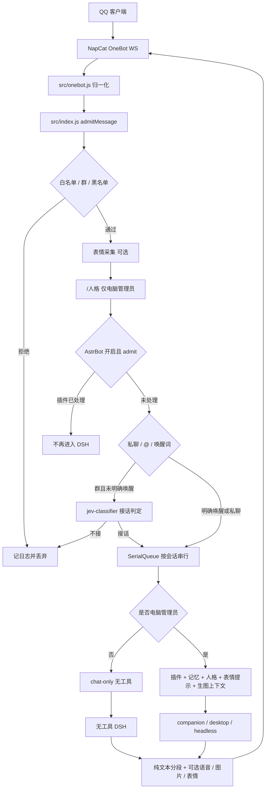

# DSH-Fatwhale-QQ 总览分析（只读）

分析对象是仓库当前 `origin/main`，版本 **v3.2.1**（`package.json`，提交 `26ef942`）。本次没有修改业务代码。结论都对照了源码；测试在本环境实际跑过，见第 3 节。

Codex 历史摘要约 66 段，时间从 2026-10-22 到 2026-11-04。其中多段是课程 PPT、技能安装、Clash 和 Cua Driver，与本仓库无关。和桥接直接相关的主线是：NAS Docker、生图、Windows 更新器、AstrBot 兼容、WebUI 日志，以及 v3.2.0 / v3.2.1 发布。历史里出现过 NAS、ComfyUI 的明文口令，本报告不复述；那些口令应视为已暴露，需要轮换，并且不要再写进对话。

作者本机未提交补丁（`codex/tray-ui-packaging` 上的工作区 diff）已对照当前文件。它的基线不是当前 `main`：`scripts/install-update.ps1` 的补丁旧 blob 是 `1f3e695`，而 `main` 与其父提交都是 `170fad1`。补丁无法直接套用。Git 源码快进更新从 `ccd36d1`（发行说明里的 v0.2.6）起就在主线上，之后又加了 runtime 白名单和独立安装器启动。这份补丁是更早快照，不应再整包重放。补丁开头的 README 片段编码已损坏，而且仍写着「源码和 Docker 只能手动更新」，和现在的 README 不一致。

## 1. 项目定位与整体架构

这是一个 **QQ ↔ DeepSeek Harness（DSH）桥**。用户在 QQ 里发消息，NapCat 用 OneBot 11 WebSocket 交给 Node 编排进程，编排进程再调用本机或容器里的 DSH，把纯文本（以及可选语音、图片、表情）发回 QQ。旁边有网页控制台、Windows 托盘、命令行、Docker / NAS 部署，以及默认关闭的 AstrBot 插件运行时。

桥接自身的 `package.json` 没有 npm 依赖，模块格式是 ESM，要求 Node ≥ 22。第三方代码放在 `src/third-party/`（croner、qrcode-generator，带许可证）。NAS 镜像会用 npm 安装固定版本的 `@deepseek-ai/dsh`；模型能力解析还会借用已安装 DSH 里的 `js-yaml`（`src/model-follow.js:101-112`）。所以「零第三方 npm 依赖」指的是桥接进程不执行 `npm install`，不是整套部署没有任何外部包。

### 1.1 进程关系

| 组件 | 形态 | 入口 |
| --- | --- | --- |
| NapCat | 外部进程或容器，OneBot WS 服务端 | Windows：`launcher/bootstrap.ps1`；通用 Compose：`docker-compose.yml` 的 `napcat`；NAS：`docker/compose.nas.yml` |
| 桥接 | `node src/index.js` | `src/index.js:158` |
| 控制台 | 独立 `node src/webui/server.mjs`，默认 `127.0.0.1:5830` | `src/webui/server.mjs:2833`；容器里由 `docker/entrypoint.sh:169-174` 和桥接一起拉起 |
| DSH | 子进程。管理员可走 companion / desktop / headless；其他人走无工具 chat-only | `src/agent-runner.js`、`src/dsh.js`、`src/chat-only.js`、`src/dsh-companion.js` |
| 托盘 | PowerShell 5.1 + WinForms | `launcher/Launcher.ps1`；一键启动是仓库根的 `一键启动.cmd` → `launcher/bootstrap.ps1` |
| CLI | `qq-bridge.cmd` → `tools/cli.mjs` | 启停桥接和控制台，不带托盘 |
| AstrBot | 可选 Python 3.12 侧车，RPC 默认 `127.0.0.1:5831`，回调 `5832` | `runtime/astrbot/qq_astrbot/__main__.py`、`src/astrbot-manager.mjs`、`src/astrbot-bridge.mjs` |
| 桌面连伴 | 装进 DSH Desktop 的小插件，经本机 HTTP 建会话 | `src/companion/lib/index.js`、`tools/install-companion.mjs` |

Windows 一键启动顺序是 NapCat → 桥接 → 控制台（失败不阻断 QQ）→ DSH 桌面程序 → 托盘。Docker 常规栈是 bridge + 可选 NapCat，控制台端口只映射到宿主 `127.0.0.1`。NAS Compose 另有认证网关 `console`、可选 profile `astrbot`，以及带 digest 约束的 NapCat。

### 1.2 消息流



准入在 `src/index.js:671` 起。群消息先过 `denyGroupIds` / `allowGroupIds` / `allowGroups`，通过后无论有没有 @ 都会记入群上下文（`rememberGroupMessage`，约 `1117`）。私聊默认 allowlist：`security.allowFrom` 为空则拒绝所有人（`src/security.js:179-187`）。AstrBot 在 DSH 队列之前分流（`src/index.js:729-747`），并且不能授予电脑操作权限。群里没有 @、也没有唤醒词时，才走 JEV；URL 和 Token 都有则请求 JEV，否则用当前默认模型做一次无工具判定（`src/jev-classifier.js`，调用点 `src/index.js:790-818`）。判定失败或超时保持静默。

真正调用模型发生在出队之后（`src/index.js:831`）。此时再次读取管理员名单；排队期间撤权会中止（`848-850`）。非管理员走 `runChatOnlyDsh`。管理员优先连伴，其次桌面宿主，再回退 headless（`src/agent-runner.js`）。

### 1.3 目录职责

| 路径 | 职责 |
| --- | --- |
| `src/` | 编排、OneBot、安全、会话、DSH、记忆、人格、表情、生图、平台自动化、AstrBot 的 Node 侧 |
| `src/webui/` | 零依赖 HTTP API 和 Material 3 前端。页签是概览、记忆、表情、人格、会话、模型、插件、自动化、系统 |
| `src/plugins/` | 现有 `ping.js`（默认开）和 `reply-tts.js`（默认关） |
| `src/platforms/` | B 站登录、搜索、动态和评论 |
| `src/companion/` | DSH Desktop 连伴插件，自身也没有 npm 依赖 |
| `launcher/` | `bootstrap.ps1`、托盘 `Launcher.ps1`、进程控制与外观 |
| `runtime/astrbot/` | 适配后的 AstrBot 4.29.3 平台、回调、ACL、代际安装和调度来源 |
| `docker/` | Alpine 入口、NAS Dockerfile、NAS Compose、认证网关 |
| `scripts/` | NapCat 安装、EXE 编译、发布、Windows 更新 helper、AstrBot Python 安装 |
| `tools/` | `cli.mjs` 以及 memory / reflect / model / qq / stickers / imagegen / package / export-public |
| `tests/` | 假 NapCat、隔离 DSH、控制台和 AstrBot 的自测；总入口 `tests/run-all.mjs` |
| `docs/` | 架构、部署、发行说明、截图 |
| `patches/` | 只入库 `example-headless-model.yml`；真实 `headless-model.yml` 被 gitignore |
| `assets/` | 托盘和图标 |

`SPEC.md` 第 1 节仍把工程写成早期的 `src/index.js + onebot + dsh + sessions` 和 `tray/TrayManager.ps1`。第 6 节已经改口说托盘迁到 `launcher/`，但目录契约没有跟上。当前实现远大于那份契约。

## 2. 关键功能与成熟度

成熟度按代码和发行说明一起看，不按 README 宣传句看。v3.2.1 验证说明写明：隔离回归、EXE、容器和便携包安装有记录；真实 QQ 投递、公开天气、真实模型供应商、从零安装和全部 AstrBot 插件仍未全面验证（`docs/releases/v3.2.1-verification.md:28-34`）。

| 功能 | 实现位置 | 默认 | 成熟度 |
| --- | --- | --- | --- |
| QQ / NapCat / OneBot | `src/onebot.js`，`src/napcat-health.js`，`launcher/lib/ProcessControl.ps1`，`scripts/install-napcat.ps1` | 需自备 NapCat；`allowFrom` 为空则拒绝消息 | 协议和健康检查在隔离测试里可用。真实登录、休眠和长期在线未作为本版验收 |
| DSH 调用 | `src/dsh.js`，`src/agent-runner.js`，`src/chat-only.js`，`src/model-follow.js` | `dsh.mode=auto`，`companion=true`，管理员 `permissionMode=danger-full-access`（`src/config.js:21-47`） | 隔离内核可用。生产核心仍声明为 0.2.0-rc.2；0.2.1-rc.5 只是受控兼容，不是生产已升级 |
| 人格 | `src/personas.js`，`src/persona.js` | 开启，库在 `state\personas` | 多套人格、按会话覆盖和热切换有测试。默认路径用了 Windows 反斜杠，见第 4 节 |
| 记忆与反思 | `src/memory.js`，`src/groupmem.js`，`src/reflect.js`，`tools/memory.mjs`，`tools/reflect.mjs` | 记忆开启；每天 04:00；每 20 轮再触发一次 | Obsidian 风格目录（人物 / 群 / 日志 / `50-反思/`）可用。调度是「每天 + 每 20 轮」，产物是 ISO 周笔记 `反思 YYYY-Www.md`。群上下文是 JSONL，不是 Obsidian 页 |
| 表情包 | `src/stickers.js`，`src/sticker-prompt.js`，`src/sticker-send-policy.js` | 采集开启，发送概率 1 | 采集、索引、迁移和发送抽签在隔离测试里通过。真实 QQ 表情元数据仍属未验范围 |
| 生图 | `src/imagegen.js` 及 client / delivery / prompt，`src/webui/imagegen-api.mjs` | **关闭**，默认 ComfyUI | 任务状态机和「创建后尚未提交就取消」已落地。真实 ComfyUI、QQ 发图和管理台在 Docker 里的鉴权还不完整 |
| 语音 | `src/plugins/reply-tts.js`，`src/tts-translation.js`，`src/reply-delivery.js` | 插件关闭；翻译也关闭 | 文字成功后才追加语音。有合成前翻译。没有语音识别 |
| 更新 | `src/updates.mjs`，`scripts/install-update.ps1` | 仅 Windows、非 Docker、且是便携包或干净 Git 检出时可安装 | 便携 ZIP 与 Git 快进两条路都在主线上。Docker、自定义配置目录、脏工作区只能手动。旧 helper 会拒绝带 `runtime/` 的新包 |
| 桌面连伴 | `src/dsh-companion.js`，`src/companion/`，`src/dsh-desktop.js` | 配置默认尝试连伴 | 协议和安装器有隔离测试。要本机 DSH Desktop 真的装上插件才有发现文件 |
| 托盘 / EXE | `launcher/`，`scripts/build-exe.ps1`，`tools/package.mjs` | 用户双击启动 | v3.2.1 在 Windows 上记录过 EXE 24/24。依赖 PowerShell 5.1、csc 和 WinForms，不能在 Linux 上当托盘跑 |
| Docker | `Dockerfile`，`docker-compose.yml`，`docker/Dockerfile.nas`，`docker/compose.nas.yml`，`docker/nas-gateway.mjs` | 常规镜像不含 DSH；NAS 镜像钉 DSH 0.2.0-rc.2 | 静态约定和常规容器有验证记录。v3.2.1 没有重做完整 NAS 镜像部署 |
| AstrBot | `src/astrbot-*.mjs`，`runtime/astrbot/qq_astrbot/`，`src/webui/astrbot-api.mjs` | **关闭**。钉 AstrBot 4.29.3 / Python 3.12.10 | 代际安装、权限、模型网关和少量锁定插件有受控记录。不承诺任意第三方插件。普通提醒限定 `is_task=false` |
| B 站 | `src/platforms/bilibili.js`，`src/platform-scheduler.js` | **关闭**；评论还要人工验收开关 | 扫码、Cron、去重和审计有夹具。真实账号、风控和评论未承诺 |
| JEV | `src/jev-classifier.js`，接入点 `src/index.js:790` | 未填 URL/Token 时用默认模型 | 隔离判定可用。真实误判率未验收 |
| JS 插件 | `src/plugins.js` | 宿主默认开；各插件看 `defaultEnabled` | 两个内置插件可用。插件能跑任意本机代码，因此只在电脑管理员出队后加载（`src/index.js:866-867`） |

## 3. 构建、运行与测试

### 3.1 怎么跑

本机 Windows 的文档路径是：

```powershell
Copy-Item config.example.json config.json
node src\index.js
node src\webui\server.mjs
```

也可以用根目录 `一键启动.cmd`（托盘）或 `qq-bridge.cmd`（CLI）。Docker 见 `docs/Docker部署.md`：先准备 `.env` 和 `data/`，再 `docker compose up -d`。镜像里没有 DSH 时，常规 Compose 必须把 Linux 版 DSH 挂进容器；NAS Dockerfile 会在构建时安装 `0.2.0-rc.2`。EXE 由 `scripts/build-exe.ps1` 用 `csc.exe` 编译，发布由 `scripts/make-release.ps1` 和 `.github/workflows/release.yml` 完成。

全量测试入口是 `node tests/run-all.mjs`。它要求工作树里没有 `config.json`，并用 `tests/helpers/run-test-case.mjs:18-21` 给子进程加上 `QQ_TEST_REQUIRE_DSH=1` 和 `QQ_TEST_REQUIRE_BROWSER=1`。README 还要求 DSH `0.2.0-rc.2` 与 Edge。Python AstrBot 用例不在这个入口里，需要单独的 3.12 虚拟环境。

### 3.2 本次实际运行

环境：Linux，Node **v22.23.4**，没有 `dsh`、PowerShell、`csc.exe`、Edge，也没有名为 `python` 的解释器（只有 `python3`）。命令：

```text
node tests/run-all.mjs
```

结果：**87 组，通过 52，失败 35，耗时 861.6 秒**，进程退出码 1。记录写在 gitignore 的 `state/test-log/20261105-055716.md`，没有进提交。另外对 `runtime/astrbot/qq_astrbot` 做了 `python3 -m compileall`，语法通过；没有安装 AstrBot 依赖，也没有跑原生插件验收。

v3.2.1 验证说明里的 87/87 是 **Windows、Node 24.16.0、装有固定 DSH 和 Edge** 的结果。下面的失败不能直接推翻那次记录，但说明这套全量入口在「文档写的 Node 22、又缺少 Windows 工具」时并不绿。

失败可以分成五类。

**缺 DSH，子进程在导入或夹具阶段退出。** AstrBot 模型网关、JEV 群聊判定（12 项里 1 项）、语音翻译（3 项里 1 项）、平台无工具模型（4 项里 1 项）、JEV 实际准入（13 项里 3 项）、DSH Web、无工具聊天内核、真 dsh 合并、smoke、三条端到端里依赖真实内核的部分、反思（15 项里 1 项）、配置与真实内核。原因都是 `src/dsh-desktop.js:54` 抛出「找不到命令 dsh」。模型思考档位那一组表面是「low 应拒绝却返回 200」，根子也是同一件事：`parseModelCapabilities` 要借用 DSH 自带的 `js-yaml`，找不到就返回 `[]`（`src/model-follow.js:111-112`），校验变成 `pending`，控制台把未知能力当成可保存。

**缺 Windows 工具或浏览器。** 四组安装集成测试打印 `SKIP portable installer integration requires Windows PowerShell 5.1`，但套件仍要求输出「失败 0 项」，于是记失败。更新控制台和 Edge CDP 要求 Microsoft Edge。托盘左键目标有 5 项在 `spawn ... powershell.exe` 时 ENOENT。B 站浏览器登录态 12 项全部 `spawnSync python ENOENT`。

**断言已经全过，进程却不退出，被套件超时杀掉。** 唤醒词（9/0）、黑白名单（20/0）、端到端插件（7/0）、模型跟随端到端（20/0）。自定义路径是 21 过 3 败之后同样拖到 120 秒。这些用例在打印成功汇总后仍占着事件循环，`run-all` 到点后记为失败。Windows 全绿记录说明那边最终能退出；Linux 上这是测试收尾问题，不是这几组断言失败。

**Linux 路径语义和默认值。** 自定义路径 3 败：`~\` 被拼成混合斜杠；`D:\p\a.md`、`E:\mem` 被当成相对路径，前面又接上了项目根。`src/config.js:623-630` 用的是当前平台的 `path.isAbsolute`，在 Linux 上不承认盘符。干净环境模拟 3 败：默认人格库和表情库落在字面目录 `state\personas`、`state\stickers`，因为默认值写成了反斜杠（`src/config.js:91`、`src/config.js:141`）。表情包有 1 败：`..\evil.png` 在 Linux 上没有被拒绝。`resolveStickerFile`（`src/stickers.js:816-825`）先 `path.resolve`；反斜杠在 Linux 不是分隔符，所以解析结果仍在库目录里，检查放行。Windows 上同一字符串会跳出目录并被拒绝。

**其余。** 管理员权限（QQ 与控制台）在大量权限断言通过后，有一条失败：`set-chat: revocation during persona reads cancels the pending modification`。它不是「找不到 dsh」。本次没有单独复跑，不能断定是稳定逻辑错误还是时序。封装应用 154 过 9 败、公开导出 113 过 10 败，失败集中在第三方文件字节、README 展示区和「产物里出现本机构建路径」。这两项在 Windows 验证里被记为通过，本次更像打包脚本把当前机器的绝对路径写进了清单，扫描器因此拒绝；需要在 Windows 打包机上再对一次，不能单凭这次 Linux 输出改打包逻辑。生图浏览器用例在任务已经完成、取消的前提下，仍报 `Timed out waiting for isolated fixture`（`tests/imagegen-ui-test.mjs:142`），本环境没有 Edge，和历史里的间歇 UI 失败不是同一次证据。

通过的 52 组覆盖了日志、NapCat 健康与概览、AstrBot 管理 / 权限桥 / 出站 / 环境事务、配置入口、限流、会话窗口、OneBot 重连、群白名单、群记忆、语音 provider、B 站适配器与扫码、平台调度、生图任务与桥接（非浏览器）、桌面连伴、桌面沙箱、群成员权限、插件宿主、文件发送、表情发送概率、人格、反思定时、CLI、Docker 静态检查、打开路径和工程审计。应用更新的「版本与下载」「HTTP 安全」两组也通过了；真正的 PowerShell 安装四组没有跑起来。

## 4. 代码质量与风险

### 4.1 控制台在 Docker 网络里几乎没有应用层身份

本地默认绑定 `127.0.0.1`（`src/webui/server.mjs:2856`）。镜像却设置 `WEBUI_HOST=0.0.0.0`（`Dockerfile:21`，`docker/Dockerfile.nas:13`）。`route()`（`src/webui/server.mjs:2540-2654`）对设置、人格、记忆、插件、模型、会话和服务控制没有统一鉴权。`PUT /api/settings` 可以改 `security.adminUserIds` 和 `dsh.permissionMode`。

NAS 把宿主端口交给 `docker/nas-gateway.mjs`：Basic 认证、有限的 Origin 检查，以及给 AstrBot 用的短时断言。Bridge 容器自己的 5830 **没有**发布到宿主，但 `docker/compose.nas.yml:19` 让它监听所有接口，并且同时加入 `private` 和 `qq-net`。NapCat 也在 `qq-net`（同文件 `162` 行附近）。同一网络里的容器可以绕过网关，直接访问 `http://bridge:5830`。

更新和自动化接口只核对 `Host` 是不是 `127.0.0.1:端口` 或 `localhost:端口`（`src/webui/server.mjs:2477-2482`），不核对 `remoteAddress`。客户端可以伪造这个 Host。生图接口同时检查回环地址和 Host（`src/webui/imagegen-api.mjs:22-28`），AstrBot 还接受网关断言（`src/webui/astrbot-api.mjs:409-422`）。结果是：

- 同一 Docker 网络里的调用者可以改设置，也可以用伪造 Host 打更新接口。
- 经过 Docker 端口转发或 NAS 网关进来的浏览器，源地址不是容器内的 `127.0.0.1`。生图接口会拒绝合法用户；AstrBot 只有走了带断言的 NAS 网关才放行，常规 `docker-compose.yml` 没有这层网关。

这是当前最值得先处理的权限缺口。它不需要公网暴露 5830；只要同网络的 NapCat 或调试容器被利用就够了。

### 4.2 电脑操作权限

管理员和聊天白名单是分开的。`isAdministrator` 只认 `security.adminUserIds`（`src/security.js:81-85`）。空名单、坏 JSON、读不到配置都会失败关闭（`src/computer-access.js`）。插件钩子和生图上下文都在出队后的 `canUseComputer` 里（`src/index.js:866`、`900`）。

默认 `dsh.permissionMode` 是 `danger-full-access`（`src/config.js:42-47`），注释写明这样管理员才能跑 shell。只要有人能写配置，把某个 QQ 加进管理员，这条会话就能使用 DSH 的完整电脑工具。非管理员不会走进这条 lane。AstrBot 插件 lane 是另一套授权，默认关闭，但按产品设计，普通群成员在被授权后可以走插件，即使 `allowGroupMembers` 为假。那不是 shell，风险取决于装了什么插件。

`/人格` 的实现只允许管理员（`src/index.js:593-599`）。紧挨着的注释仍写「只有白名单里的人能换」（`721`），和代码不符。

`privatePolicy=blacklist` 时，私聊对黑名单以外的人默认放行（`src/security.js:59-61`、`184`）。这是显式策略，但和「`allowFrom` 为空就拒绝一切」的直觉相反，误开的代价很大。

### 4.3 命令执行与密钥

生产路径里的 `spawn` / `execFile` 使用参数数组。`src/dsh.js` 明确避免把任务文本交给 shell。更新器用 Base64 的 `-EncodedCommand` 启动固定脚本（`src/updates.mjs:97-108`）。安装脚本有路径、重解析点和 ZIP 白名单。风险主要在「谁能调用更新 API」，不在安装脚本把用户字符串拼进 shell。

密钥落在 `config.json` 和 `.env`，这两类文件被 gitignore。控制台对一部分字段打码，但 `src/redact.js` 的规则有限，`src/onebot.js` 的 debug 日志是截断 JSON，不是按密钥规则打码。NAS 网关口令以 SHA-256 存放，仍是可离线猜测的 Basic 口令。

常规 Compose 的示例把 NapCat WebUI token 默认成 `qqdsh`（`.env.example:51`，`docker-compose.yml:58`）。端口虽然映射在 `127.0.0.1`，这仍是一个公开的默认值。NAS Compose 改成了必填，没有这个默认值。

### 4.4 生图状态机

`20aae46` / `bf7d4ba` 已经处理历史里的「`created` 且没有远端编号」：`resume` 会在锁内取消并清掉 worker，然后旧 token 不能再提交（`src/imagegen.js:316-323`）。本次非浏览器生图测试通过，日志里也能看到「已取消尚未提交的任务」。

残留点还在：

- `saveWorker(..., { status: 'submitting' })` 仍在提交用的 `try` 之外（`src/imagegen.js:277-279`）。这一步失败时，任务会停在 `created`。
- 控制台 `launch()` 在 `onCreated` 时就对调用方返回，随后的拒绝被空的 `catch` 吃掉（`src/webui/imagegen-api.mjs:55-62`）。界面会看到「准备中」，除非再点恢复；恢复现在会取消它，而不是永远卡死。
- `submitting` 或已经有远端编号时，活着的 worker 仍会挡住取消。这是有意留下的，避免重复付费 POST。
- `monitor` 把非 `IMAGEGEN_*` 错误收成可恢复的 `paused`（`src/imagegen.js:240-242`），排障时不容易看到原始异常。

QQ 图片仍不会作为视觉输入。`countImages` 只计数；纯图片消息被写成 `[图片]` 放进群上下文（`src/index.js:1126-1129`）。历史只读结论到现在还成立。

### 4.5 更新器与跨平台

`inspectEnvironment`（`src/updates.mjs:265-307`）只允许 Windows 且非 Docker。干净的独立 Git 检出走 `source`，带 `qq-bridge.exe` 的目录走便携 ZIP。自定义 `state` / `config` 路径、worktree、符号链接和脏工作区都会拒绝应用内安装。Node 侧 `defaultRunGit` 加了 `core.hooksPath=/dev/null`（`src/updates.mjs:136`）。PowerShell helper 用临时空 hooks 目录，并在快进失败时尝试 `reset --keep`。

`defaultLaunchInstaller` 不再用会随控制台一起死掉的 detached `spawn`，而是短生命周期 PowerShell 加 `Start-Process -WindowStyle Hidden`，并用 `WildcardPattern]::Escape` 处理含 `[` `]` 的路径（`src/updates.mjs:97-108`）。这正是 2026-10-29 到 11-03 反复修的那条线，已经在主线上。

非 Windows 的进程树清理走 SIGTERM / SIGKILL（`src/dsh.js:267` 起）。控制台的「启动 / 停止服务」仍固定调用 `powershell.exe`（`src/webui/server.mjs:2244-2247`），在 Linux 容器里会失败。默认配置路径的反斜杠会在 Linux 上变成目录名的一部分，见第 3 节测试。

`docker/compose.nas.yml:37` 的注释仍写「NapCat 是 host 网络，看到的是宿主真实路径」。当前服务定义把 NapCat 放在 `qq-net` 上，并发布 `16099:6099`，不是 host 网络。文件要给 NapCat 读时，必须靠卷和 `files.mappings`，不能按这句注释假设路径相同。

### 4.6 AstrBot

Python 入口、RPC 和代际目录现在是有的；2026-10-30 那次中断时「还没有 `__main__`」的检查点已经过时。仍要注意：

- 默认关闭，锁定 4.29.3，不跟随上游 latest。传递依赖没有全部 hash 锁定，运行时另有 inventory。
- Worker 在 `create_subprocess_exec` 之后才挂上 Job / 进程组（`runtime/astrbot/qq_astrbot/server.py:73-80`，`generation.py` 里对应的 spawn 同样如此）。启动后、挂上限制前的一瞬间，子进程再拉起的孙子进程不会被这次 Job 收走。历史复核把这定成 P2，代码还是这个顺序。
- 回调和媒体要经过 Node 的 `astrbot-media://`，不能把容器内绝对路径直接交给 NapCat。
- 定时发送依赖持久的 context / epoch。撤权、回滚和冷启动曾经反复出错；v3.2.1 明确这些原生验收属于 v3.2.0 基线，本版没有重做。

### 4.7 其他技术债

- `SPEC.md` 的目录、DSH 命令行和配置字段只覆盖最初的 headless 桥，不能再当接口真相。
- README 开头两段几乎重复的 v3.2.1 横幅（约第 1 行和第 14 行），像导出脚本叠了两次。
- `qq-bridge.cmd` 仍提示安装 Node 20+，README 和 Docker 是 Node 22。
- 控制台主体 API 在本机也没有 CSRF token，只靠回环绑定。本机网页仍可请求 `http://127.0.0.1:5830`。更新、自动化、生图、AstrBot 有额外 token，其余接口没有。
- 记忆笔记对「尚不存在的路径」会跳过 realpath，存在本地符号链接时序窗口（`src/webui/server.mjs` 的 `resolveNotePath` / `putNote`）。利用它需要已经能在本机改目录。
- 全量测试强依赖 Windows、DSH 和 Edge，但 README 把 Node 22 写成最低版本。Node 22 的 Linux 运行者会看到大量红，其中多数不是业务断言失败。

## 5. 历史里反复出现、以及文档和代码不一致的地方

### 5.1 反复出现、不能当成已经结案的问题

1. **Windows 应用内更新。** 从「detached PowerShell 静默退出、没有结果」，到路径里的 `[` `]` 让 `Start-Process` 重定向失败，再到 CI 上安装器启动慢、`EBUSY` 删目录、PID 复用导致清理等待挂住。主线已经换成独立隐藏控制台，并有 runtime 白名单。作者手头的补丁是这条线的旧稿。还没在本次环境里重跑 PowerShell 安装四组；v3.2.1 说明里的 84 项是 Windows 上的记录。旧 portable helper 复制的是「当前已安装的脚本」，不会自己学会安装 `runtime/`，从 3.1.5 及更早自动升到 3.2.x 仍要先手动换一整包。

2. **生图任务停在「准备中」或变成 `unknown`。** 根因路径修过一轮，`created && !remote` 可以取消。`submitting` 那一步仍在 `try` 外，API 仍会吞掉创建之后的异常。QQ 里「生成了但没发出去」还依赖桥接和 NapCat 是否看得到同一文件；NAS 注释和实际网络模式不一致，这条很容易再出现。

3. **图片没有交给模型。** 2026-10-29 的只读结论现在仍然成立：QQ 图片变成占位文字，不是视觉输入。

4. **NAS 上控制台日志是旧的或假的。** v3.2.0 改成按日期读桥接日志，并用 NapCat WebUI 的实时流，不再回退旧 console 文件。v3.2.1 没有把完整 NAS 部署重做一遍。还要确认生产配置有 `QQ_NAPCAT_WEBUI_URL=http://napcat:6099`，而不是容器里去连 `localhost:6099`。

5. **DSH 渠道 503、版本号和「到底哪一个 DSH 在跑」。** 最早一段对话的结尾仍是上游 503，不是桥接修完就能消掉的。桌面端、headless、容器里挂载的包和 `dsh` PATH 是四套东西。README 同时写「0.2.1-rc.5 已验证」和「生产核心仍是 0.2.0-rc.2」，容易读成生产已经升级。

6. **AstrBot。** 这是历史里最长的一段：多代理并行、中途禁止测试、再开放 NAS、提醒 cron 字段写错、冷恢复身份对不上、天气授权、Windows venv 重定向导致 PID 不一致。现在默认关闭，四个锁定样本和部分定时场景有记录，但发行说明仍排除「全部插件」、任务型提醒和授权页与原生 runtime 的完整联调。

7. **真实 QQ 收发。** 几乎每个发行说明都把真实文字、图片、语音和定时投递留在未验证范围。隔离收集器通过不能代替手机上收到消息。

8. **控制台在 NAS 上「谁可以访问」。** 历史里既要求局域网能管插件，又要求不能匿名。现在的实现是网关 Basic + 桥接本体在 Docker 网络内无鉴权，两边的强度不一样。

### 5.2 文档和代码不一致

| 文档 | 代码 |
| --- | --- |
| README 快速开始写 `launcher\一键启动.cmd`（约第 162 行） | 一键启动在仓库根目录 `一键启动.cmd`，`launcher/` 下没有这个文件 |
| README 目录树只列 `src`、`webui`、`plugins`、`launcher`、`tools`、`tests`、`docs` | 还有 `runtime/`、`docker/`、`scripts/`、`patches/`、`assets/`，以及根上的 Dockerfile 和 Compose |
| README 说回复语音「不包含语音识别和翻译」 | 没有识别；`reply-tts` 有「合成前翻译」，默认关（`src/plugins/reply-tts.js:52`） |
| `qq-bridge.cmd` 提示 Node 20+ | README、`Dockerfile` 和测试注释是 Node 22；v3.2.1 的 Windows 验证用的是 Node 24.16 |
| `SPEC.md` 第 1 节的目录和 `dsh --profile headless` 契约 | 实际还有 desktop、companion、chat-only、AstrBot、生图和平台自动化 |
| `src/index.js:721` 注释：人格指令只限白名单 | `handlePersonaCommand` 只限电脑管理员（`593-599`） |
| `docker/compose.nas.yml:37`：NapCat 使用 host 网络 | 服务在 `qq-net`，并映射 `16099:6099` |
| README「九个页签」 | 与 `src/webui/public/index.html` 的九个导航一致，这一条是对齐的 |
| 记忆「每天 04:00」和「周反思」 | 两件都是真的：每天和每 20 轮触发，写的是当周那一篇 |
| 作者补丁里的 README：源码和 Docker 只能手动更新 | `src/updates.mjs:240-259` 在干净 Git 检出上会走源码安装；Docker 仍是手动 |

## 6. 后续建议（按优先级）

### P0

1. **收紧 Docker / NAS 控制台的信任边界。**  
   原因：同网络容器可以改管理员名单和 `danger-full-access`，也可以伪造 Host 触发更新。  
   位置：`src/webui/server.mjs` 的 `route`、`routeUpdates`、`routeAutomation`；`Dockerfile` 与 `docker/Dockerfile.nas` 的 `WEBUI_HOST`；`docker/compose.nas.yml` 的网络；`docker/nas-gateway.mjs`。  
   方向：写操作统一校验来源。要么只听回环、由网关代转并校验断言，要么所有管理接口都认同一套断言，并且用 `remoteAddress` 而不是只看 Host。先给「伪造 Host 调用 `/api/updates/install`」和「从非回环地址 `PUT /api/settings`」加失败用例。

2. **不要把本机那份更新器补丁再贴回主线。**  
   原因：它基于旧 blob，和 `main` 冲突；源码更新、隐藏安装器和 runtime 白名单已经在更新的提交里。硬套会盖掉后来的修复。  
   位置：`src/updates.mjs`、`scripts/install-update.ps1`、`src/webui/public/app.js` 及三个更新测试。  
   方向：先把 `codex/tray-ui-packaging` 更新到 `origin/main`，再只保留 diff 里仍然不存在的行为。补丁开头的 README 编码已坏，不要用它覆盖现在的 README。

### P1

3. **让生图和 AstrBot 管理在「端口映射 / NAS 网关」下可用，同时不要放宽第 1 条。**  
   原因：这两处比其他接口更严，合法的 Docker 用户会被 403，同一网络的伪造 Host 反而能碰到更危险的更新接口。  
   位置：`src/webui/imagegen-api.mjs:22-28`，`src/webui/astrbot-api.mjs:409-422`，`docker/nas-gateway.mjs`。

4. **修正 Linux / 容器上的默认路径。**  
   原因：本次测试已经得到字面目录 `state\personas` 和 `state\stickers`，Windows 绝对路径也会被接在项目根后面。干净 Docker 启动会把人格和表情写到错误位置。  
   位置：`src/config.js:89-94`、`139-141`、`623-630`。默认值改成正斜杠；解析时明确拒绝或转换 foreign 盘符，不要静默拼进项目根。

5. **把 QQ 图片的产品行为写清楚，或真正传给模型。**  
   原因：这是历史里查过、代码里仍只做计数的缺口。用户会以为机器人「看见了图」。  
   位置：`src/index.js:104-111`、`1126-1129`，以及 `runAgent` 组 prompt 的地方。若短期不做视觉输入，回复和文档应明确只收到占位符。

6. **生图创建后的异常不要再被吞掉。**  
   原因：`submitting` 失败时界面停在准备中，调用方看不到 `IMAGEGEN_BUSY`。取消路径已经能收拾 `created`，但用户要自己再点一次。  
   位置：`src/imagegen.js:270-279`，`src/webui/imagegen-api.mjs:55-62`。把状态推进放进同一个失败处理，创建之后的拒绝要写回任务并返回给 API。

7. **对齐 NAS 文件可见性和 Compose 注释。**  
   原因：生图或文件消息「本地有文件、QQ 没收到」会反复出现。注释说 NapCat 用宿主网络，定义却在桥接网络里。  
   位置：`docker/compose.nas.yml:37` 与 napcat 服务；`src/index.js` 的 `sharedMediaMappings`；`src/file-bridge.js`。

8. **补一轮仍被发行说明排除的真实验收，而不是再加功能。**  
   原因：真实 QQ 文字 / 图片 / 语音、公开天气、从零安装、NAS 镜像重建，在 v3.2.0 和 v3.2.1 都列着。历史里这些最容易在「测试通过」之后于生产暴露。  
   位置：`docs/releases/v3.2.1-verification.md:28-34`，以及对应的 `tests/astrbot-*-native.mjs` 开关。

### P2

9. **AstrBot worker 先挂上进程树限制，再进入可执行插件的窗口。**  
   位置：`runtime/astrbot/qq_astrbot/server.py:73-80`，`generation.py` 中同样的 spawn。这是故障隔离，不是对抗恶意插件的沙箱；文档应继续这样写。

10. **模型能力解析失败时不要把任意思考档位存进去。**  
    原因：没有 DSH、因而没有 `js-yaml` 时，控制台对 `low` 返回 200。瘦镜像正好是这个状态。  
    位置：`src/model-follow.js:101-112`、`141-163`，`src/webui/server.mjs` 保存手动模型的分支。

11. **改测试入口，让「跳过」和「失败」分开，并让桥接测试在 Linux 上自己退出。**  
    位置：`tests/run-all.mjs`，`tests/install-update-test.mjs:280`，`tests/bili-cookies-test.mjs`（它调用 `python` 而不是 `python3`），以及打印完全部断言后仍不退出的端到端用例。超时杀掉一组已经 0 失败的用例，会把环境问题伪装成回归。

12. **把 SPEC 降级或重写成索引。**  
    位置：`SPEC.md` 全文，尤其是第 1 节和第 4 节。现在以 `src/index.js`、`src/config.js` 和 `docs/控制台架构.md` 为准，否则后续并行修改会按过期签名开工。

13. **改掉会误导下一步的注释和文案。**  
    README 的重复横幅、一键启动路径、语音「不含翻译」、`src/index.js:721`、NAS host 网络注释、`.env.example` 里的 `qqdsh`。默认 token 至少改成空值并拒绝启动，而不是一个写在仓库里的固定字符串。

14. **管理员撤权与人格修改的那条失败断言单独复跑。**  
    位置：本次日志中的 `set-chat: revocation during persona reads cancels the pending modification`，测试在 `tests/admin-access-test.mjs`。若在 Windows 上稳定复现，再改 `src/personas.js` 与 `src/index.js` 的读改写锁；本次证据不够把它定成已确认缺陷。

## 结论

这个仓库已经不是 SPEC 里的那个「OneBot 进、headless DSH 出」的小桥。它是一套以 Node 编排为中心的 QQ 机器人：管理员走完整 DSH，其他人走无工具通道，旁边有控制台、托盘、记忆库、表情、可选生图 / 语音 / B 站 / AstrBot。主干功能在隔离测试里是成形的，v3.2.1 也明确没有把真实 QQ 和全部插件算进通过范围。

当前最需要补的不是新功能。先处理 Docker 网络内的控制台权限，再处理 Linux 默认路径和生图异常被吞掉的问题，并把作者本地那份更新器补丁和 `origin/main` 对齐，避免把已经修过的安装器盖回去。本次在 Node 22 的 Linux 上跑完全量入口，52/87 通过；失败主要是缺少 DSH、PowerShell 和 Edge，另有几组断言已通过但进程不退出，以及反斜杠默认路径在 Linux 上被实测打中。
