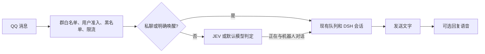

# 免唤醒对话、回复语音与 B站自动化

## 对话处理

参考 AstrBot 的事件链和插件配置约定，桥接保留原有会话与权限逻辑，在群聊准入和 DSH 调用之间增加 JEV 判定：



私聊无需唤醒词。群消息仍先检查群与用户权限；明确 @ 或唤醒词直接进入原有会话，普通消息只有判定为对机器人说话才接入。JEV URL 和 Token 均非空时使用 JEV；任一缺失时使用当前 DSH 默认模型，并跟随控制台的模型选择。两种方式都使用本群有限条近期消息和机器人已发送的回答，不读取其他群的上下文。默认模型判定使用全新、无工具的会话。JEV 已配置时若请求失败，不切换到其他服务；任何判定失败、超时或不明确的结果均不回复。同群消息按到达顺序完成准入，不会因分类响应快慢而倒序；其他群独立处理。未明确唤醒的普通群消息触发限流时保持静默。

控制台「系统」页填写 JEV Base URL、Token、模型名、超时与上下文条数。接口使用 OpenAI 兼容的 `/chat/completions`。Token 保存后不回传；输入框留空表示保留原值。群白名单使用原有 `security.allowGroupIds`；是否允许普通群成员参与使用原有 `allowGroupMembers`。JEV 与插件设置沿用控制台的桥接重启生效提示。

## 回复语音

控制台「插件」页的「回复语音」默认关闭。该插件通过 `afterReply` 注册文字发送之后的任务。只有文字所有分段发送成功才运行语音合成；语音合成或发送失败不影响已发送的文字。

平台可选 Edge TTS、OpenAI、硅基流动和自定义 OpenAI 兼容服务。Edge TTS 复用 `edge-tts` Python CLI，运行桥接的电脑需要为所选 Python 安装：

```powershell
python -m pip install -r tools/requirements-voice.txt
python -m edge_tts --help
```

插件配置包含 Python 命令、音色、最大字符数和超时。默认音色为 `zh-CN-XiaoxiaoNeural`，默认最多 600 个字符、60 秒合成超时。Edge 合成文本通过 stdin 传入；临时文件在成功、失败或取消后清理。音频以 OneBot `record` 段的 `base64://` 数据发送，不依赖 NapCat 与桥接共享文件路径。不包含语音识别。

v1.4.0 新增独立的“语音语种”（`speechLanguage`），默认自动。指定 Edge 语种会选择相应音色，自定义兼容接口则发送 `language` 扩展字段，须服务支持；OpenAI、硅基流动只提供自动。语种设置不触发翻译，关闭翻译后直接朗读原文。翻译专用字段仅在开启翻译时显示，关闭后保留偏好。当前 Irodori 模型只支持日语，设置中文不会令其获得中文能力。

v1.3.0 可开启“合成前翻译”，目标语言默认日语，可填写附加翻译要求，翻译默认另有 60 秒超时。文字全部发送成功后，使用当前 DSH 模型和模型补丁，在全新、无工具、无历史的会话中翻译，再把译文送入所选 TTS；QQ 文字保留原文。翻译异常、空结果、超时或取消时跳过语音，不回退为原文合成。这参考了 `miku05231/astrbot_plugin_translate_tts` 的处理顺序。翻译作为当前回复任务的一部分执行，不嵌套提交到同一串行队列。

API 平台使用 `POST /v1/audio/speech`，填写服务根地址、语音模型、API 音色和可选密钥；不依赖本机 Python。自定义兼容平台的 API 音色可留空，此时请求省略 `voice` 并使用服务默认音色。音频格式可选 MP3 或 WAV，默认 MP3；Irodori-TTS 使用模型 `irodori-tts`、空音色和 WAV。密钥留空时不发送鉴权头，保存后不会回显，勾选“不使用密钥”可清除。配置保存后重启桥接生效。示例和平台默认值见 [多平台接入](media-providers.md)。

Provider 合同为 `synthesize(text, {outputFile, speechLanguage, voice, python, baseUrl, model, apiVoice, responseFormat, apiKey, timeoutMs, signal})`。普通聊天的可信语音插件不会开放管理员专用的任意用户插件或电脑工具。

2026-10-25 的 Irodori 局域网排查表明，HTTP 200、有效 WAV 和存在波形都不足以证明内容正确。补齐翻译后仍有异常，SSH 排查发现 LoRA 的 71 条训练文本全部是同一句占位句。停用该 LoRA 并使用原模型加真红参考后，日语直输、默认调用、真实翻译和 QQ 转码后的短句转写均与目标一致；人工试听和长文仍待验收。见 [诊断报告](tts-translation-diagnosis-20261025.md)。

## 自动化配置

控制台「自动化」页可配置：

| 字段 | 用途 |
| --- | --- |
| 启用 B站自动化 | 默认关闭；开启前必须填写来源和 QQ 目标 |
| Cron | 5 字段、本机本地时间，例如 `0 9 * * *` |
| 关键词 | 每行一个，搜索最新视频 |
| UP 主 UID | 每行一个，读取其近期动态 |
| QQ 推送目标 | 私聊填 QQ 号，群聊填 `g:群号` |
| @ UID | 自动评论时唯一允许提及的 B站账户 |
| 自动评论与人工验收开关 | 两者均确认后才允许发布 |
| B站登录 | 优先扫码登录；浏览器导入作为备用入口 |

调度器只在桥接进程中运行一份，控制台只保存配置、读取状态和排队。OneBot 连接就绪后启动，断开或退出时停止。自动化设置每轮从磁盘读取，来源或发布设置在运行中被撤销时会在发送前重新检查。

Cron 复用 MIT 许可的 Croner，源码与许可证包含在 `src/third-party/croner/`。漏跑时只补最近 24 小时内的最近一次计划；结果入队后确认该次计划，平台读取短暂失败时下次调度可恢复。关键词结果与 UP 动态按 BVID 合并，推送进度按 QQ 目标分别记录。单次接口只读取最近一页，并非历史全量抓取。

摘要、相关性和评论正文复用当前 DSH 模型，使用新的无工具聊天运行时，不接入 QQ 私聊或群聊历史。网络内容作为不可信引用传入，不向模型提供 Cookie 或账号凭据。

## 登录态与发布

在「自动化」页点击「扫码登录 B站」，使用哔哩哔哩 App 扫描二维码并在手机上确认。控制台显示扫码、待确认、登录成功和过期状态；二维码三分钟内有效，可以刷新或取消。登录成功后验证账号并保存登录态，不会开启自动化或自动评论。此流程不依赖浏览器 Cookie 数据库，也不需要 Python。

二维码由本机的 MIT 许可 `qrcode-generator` 生成，依赖及许可证在 `src/third-party/qrcode-generator/`。扫码密钥仅在后端内存中短暂保留，过期或取消后清理。刷新和取消会阻止尚未提交的登录保存；保存已经开始时，取消会等待并报告实际保存结果。HTTP 只返回本地生成的二维码图像、会话标识与状态，不返回 Cookie、扫码密钥或登录跳转链接。

备用的「从浏览器导入」复用已有 `tools/bili_cookies.py`，需要本机 Python 和 `cryptography`。扫码或导入后都会验证 B站登录状态；验证失败不会覆盖旧凭据。Cookie 只保存在本机状态目录，不进入配置读取响应、运行日志或评论审计。部分新版浏览器的应用绑定加密 Cookie 可能无法提取，此时使用扫码登录。

导入只读取所选浏览器，不会失败后自动切换另一个浏览器的账户。失败提示会区分数据库占用、未登录、解密依赖缺失和不支持的 v20 应用绑定加密；日志只记录固定错误代码。

若提示 Cookie 数据库被占用，需完全退出所选浏览器及其后台进程后重试。托盘打开的控制台也是 Edge 窗口，可能占用同一数据库；可先用其他浏览器打开本机控制台地址，再退出 Edge 并导入。数据库占用解除后，如果出现 v20 提示，仍表示当前提取工具不支持该加密格式，重新安装 Python 无法解决。

关键词搜索采用当前平台的 WBI 签名接口。搜索需要可用的登录态；扫码后会补齐搜索所需的设备标识。动态订阅能否匿名访问由平台决定。平台返回错误时不生成虚假结果。

自动评论遵循以下限制：

- 同一动态只保留一次发布尝试记录，重启或重新导入 Cookie 不会重试该动态。
- 每个本地自然日最多 3 次发布尝试，相邻尝试至少间隔 30 分钟，跨日仍遵守间隔。
- 发布前和登录/UID 解析完成后再次检查配置、当前时间与限额。
- 评论资源使用平台明确返回的 `comment_id_str` 和 `comment_type`；缺失时拒绝发布。
- @ 名称从指定 UID 解析；模型正文不能自行增加 @。
- 平台拒绝、登录失效或结果不确定时停止后续发布，记录脱敏原因；不自动重试 POST。
- 审计包含动态、目标 UID、正文、执行时间和结果。崩溃遗留的待确认记录会阻止自动发布。

“立即检查”只由控制台排队。即使自动化关闭，也可以手动检查并推送到配置目标，但关闭状态下不会评论。桥接未运行或未连接时任务等待桥接恢复。重新导入并验证登录态是显式恢复操作，既有失败/不确定动态仍保留去重记录。

真实评论必须由用户明确启用，并完成小范围人工验收后才验证。实现与自动化测试不会替用户导入真实 Cookie、开启发布或发出真实评论。

## 内部接口与测试

适配器工厂提供 `search`、`dynamics`、`validateLogin`、`resolveMention` 和 `publishComment`。调度器接收适配器、模型、时钟和 QQ 发送器；控制台接收独立的控制接口。这些注入点使测试无需真实账号或网络即可验证完整链路。

新增测试入口：

```powershell
node tests/jev-classifier-test.mjs
node tests/jev-admission-test.mjs
node tests/reply-tts-test.mjs
node tests/reply-delivery-test.mjs
node tests/tts-translation-test.mjs
node tests/bilibili-test.mjs
node tests/bili-cookies-test.mjs
node tests/bilibili-login-test.mjs
node tests/bilibili-login-integration-test.mjs
node tests/platform-scheduler-test.mjs
node tests/platform-model-test.mjs
node tests/platform-webui-test.mjs
node tests/e2e-platform-voice.mjs
```

可选真实浏览器检查：设置 `QQ_PLATFORM_BROWSER_TEST=1` 后运行 `platform-webui-test.mjs`。它创建临时控制台与独立浏览器配置，不使用运行账号。另应回归既有 `wake-word`、`webui`、`plugins`、`e2e-plugins` 和权限测试。

参考实现：AstrBot 插件事件链；rany2/edge-tts 官方 CLI；Hexagon/croner；bilibili-api 的资源类型与 B站接口收集文档；OpenCLI 的评论与 WBI 参数处理。保留本工程已有插件配置、群记忆、会话与 OneBot 发送约定。
