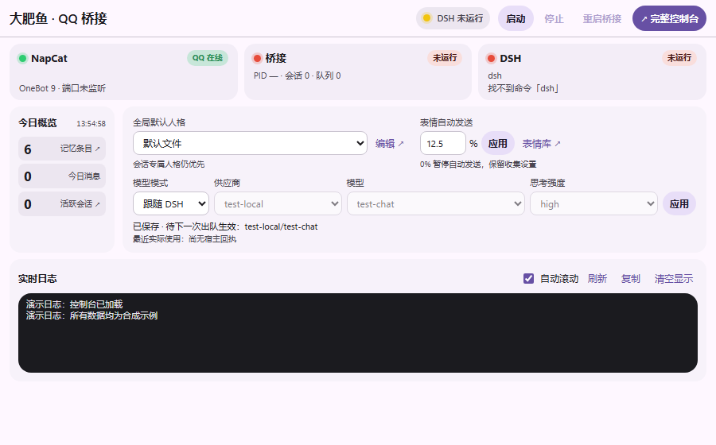
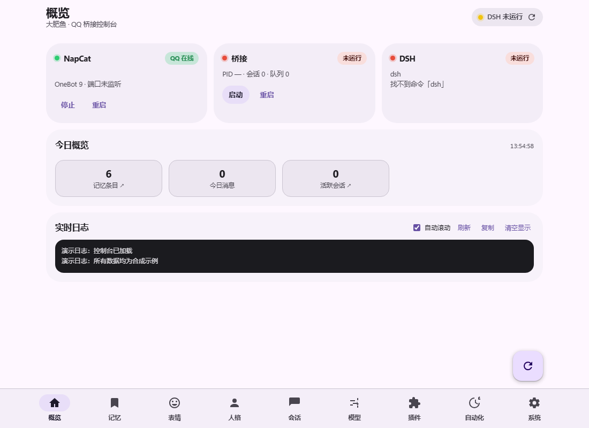

# QQ-DSH v3.3.0

本版将桥接核心纳入 DSH 宿主进程，更新 DSH 0.2.2 兼容层、插件页控制台和本机浏览器联动，并修复控制台前缀、服务挂载顺序与异步启停问题。AstrBot 仍为默认关闭的可选功能。

部署主线为 NapCat 可在 Docker 中运行、DSH 在宿主常驻、桥接由 DSH 插件承载和管理。本轮不安排桥接或 DSH 的 Docker／NAS 开发、构建与验收。

## 控制台双模式

DSH 插件页使用紧凑面板，统一显示状态、桥接启停／重启、快捷设置和日志；完整九页控制台通过系统默认浏览器打开。浅色、深色、窄屏与键盘操作使用同一套页面。

- 人格快捷切换作用于全局默认项，不覆盖已有群／会话人格。
- 模型区保留未保存草稿，区分目标与实际使用；新目标在后续出队请求应用。
- 表情频率只修改发送概率，保留合法小数；0 暂停发送，保留表情库和收集设置。
- 日志增加跟随、刷新、复制和清空显示，不删除磁盘记录。
- 内嵌页使用当前桥接专用 controller；NapCat、DSH 卡片只读，避免快捷操作结束宿主。

## 本机打开完整版

插件按需启动一个仅绑定 `127.0.0.1` 的动态端口，复用同一控制台与桥接。浏览器通过 60 秒一次性授权码兑换独立会话，不导出 DSH Cookie。入口支持指定功能页，拒绝任意 URL；服务撤销或插件退出时关闭监听并撤销会话。

## 修复与兼容

- 用 HTML 元数据传递控制台前缀，保持 `script-src 'self'`，不再依赖被 CSP 拦截的内联脚本；人格、表情与图片预览请求遵循挂载前缀。
- HTML 属性转义和替换回调保留特殊前缀中的字面字符。
- 控制台等待宿主 Web 与认证服务就绪再注册路由；服务撤销、恢复和异步取消时释放资源。
- 显式配置文件独立确定数据根目录，静态资源仍取自源码目录；异步启动完成后才返回状态。
- 适配 DSH 0.2.2 的模型选择与拆分执行器；保留旧版本选择接口回退。普通成员由权限限制与 guard 禁止调用工具，组件本身可能被加载。
- 完整 bundle companion **0.3.0** 默认使用 **embedded 进程内桥接**，启用后自动启动；停止、禁用或卸载不会退出 DSH。管理员直接调用同一宿主，普通成员继续隔离聊天。
- 保留旧独立运行入口的 standalone 兼容。修复同步启动失败、空闲停止和并发启停的生命周期边界，取消旧请求后不回写运行 PID。
- 完整页旧桥接按钮与内嵌页共用插件控制器，不通过 Windows ProcessControl 停止承载桥接的宿主。

## 升级与使用

**插件用户推荐下载 `qq-bridge-3.3.0-source.zip`**，保留完整解压目录，在 DSH 安装其中的 `src/companion`。逐步安装与配置见 [README 安装与使用](https://github.com/miku05231/DSH-Fatwhale-QQ#安装与使用)。Windows 便携包也包含完整项目，可按同样方式安装 bundle。

Release 中的 `qq-bridge-launcher-3.3.0.exe` 是兼容旧托盘／独立服务部署的启动器，**不是 DSH 插件安装包，插件模式无需运行**。单个 EXE 不包含完整项目和宿主运行环境，也不能独立更新插件。`SHA256SUMS.txt` 用于校验三个下载文件。

更新前先停止插件桥接并备份配置和数据，再更新完整项目文件，保留本地配置、状态、记忆和自定义内容，最后重新启动 DSH。已有手工修改的源码目录应先审阅差异。旧更新 helper 的 runtime 兼容边界见 [v3.2.0](https://github.com/miku05231/DSH-Fatwhale-QQ/blob/v3.3.0/docs/releases/v3.2.0.md#便携更新兼容)。

插件客户端需要完整 bundle：Desktop 从原生插件页安装 `src/companion`，Web 按 [使用说明](https://github.com/miku05231/DSH-Fatwhale-QQ/blob/v3.3.0/docs/console.md) 安装。旧 server-only 安装脚本不能提供客户端面板。迁移旧 server-only 配置时明确设置 `runMode: embedded`，保留四个数据路径且避免重复 insert。插件页与托盘／命令行应选择一种桥接启动入口。

NapCat 在 Docker 中运行时，将 OneBot 地址配置为宿主 DSH 可达的正向 WebSocket 地址；桥接与 DSH 沿用宿主插件流程，见 [部署边界](https://github.com/miku05231/DSH-Fatwhale-QQ/blob/v3.3.0/docs/Docker部署.md)。无需为本版重新构建桥接或 DSH 镜像。新的浏览器授权入口只面向本机使用，本版不新增远程控制台能力。

## 验证范围

准确结果、参考环境与发布前尚待检查项见 [v3.3.0 验证记录](https://github.com/miku05231/DSH-Fatwhale-QQ/blob/v3.3.0/docs/releases/v3.3.0-verification.md)。源码候选通过不等同于正式安装包或 GitHub Release 已验证。

历史版本及 3.4 测试版的验收结果分别保留，不计入本候选。记录中的测试结果仅适用于其对应源码候选；进程内桥接源码与隔离验证结果以当前验证记录为准；本轮没有新增原生客户端、真实 QQ 或容器验收结果。真实 QQ 收发、语音提供方、全新安装、原生协议及完整发布流水线须按该记录分别判断；本版不宣称解决语音提供方故障。Docker／NAS 不在本轮范围，旧容器材料保留为可选历史材料。
